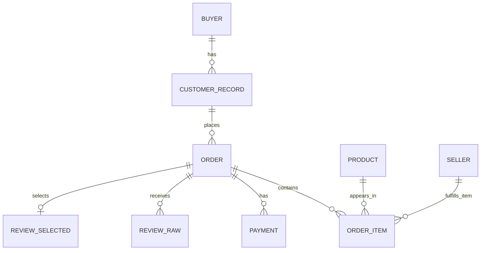

# 电商交易与履约分析数仓系统的设计与实现

本文对应课程报告的前五章，确定业务范围、指标口径、概念模型、逻辑模型及数据库物理方案，作为后续数据验收、ETL 开发和可视化实现的依据。

设计版本：2026 年 10 月 22 日。本文件保存设计依据，系统实现已在同日完成，实际运行和验证见《04_系统实现_第六章.md》。全部 9 个源 CSV 已导入 PostgreSQL，层间对账、重跑、回滚、空库构建、权限、备份恢复和查询性能已有证据。共 99,441 笔订单，其中一笔已送达订单缺失支付，源支付完整性仍未通过；实际实现发布带覆盖率的“已记录支付金额”，并将“完整支付金额”置为 NULL。交互看板仍待完成。

## 1 项目背景

### 1.1 行业背景与业务问题

电商平台的交易活动涉及客户下单、商品销售、支付、配送和评价等环节。业务数据通常按照业务对象分别保存，能够记录单笔交易，却不便于直接回答跨时间、跨地区及跨品类的经营问题。例如，订单增长是否伴随配送时效下降，不同客户地区的到货情况有何差异，以及配送延迟是否与低评分同时出现，都需要统一关联和加工多个数据源。

本项目以巴西电商平台 Olist 的公开交易数据为对象，建设面向运营分析的离线数仓。通过统一数据口径、整理业务维度和建立事实模型，将订单、商品明细、支付及评价数据转换为可查询、可追溯的分析数据，为交易规模分析、履约问题识别和用户体验分析提供支持。

### 1.2 项目目标

项目需要形成一条可复现的数据处理链路：真实 CSV 数据进入原始层，经清洗和维度建模生成事实数据，进一步汇总为分析指标，最终展示在交易概览、履约分析、用户评价三个看板中。

具体目标包括：统一订单数、商品金额、运费和支付金额的定义；支持时间、客户地区、商品品类和卖家等维度的分析；定位配送耗时较长、逾期比例较高的订单群体；分析不同配送时效下的评分分布；通过质量检查和源数据对账保证结果可解释。

### 1.3 数据来源与分析边界

数据源采用 Kaggle 上由 Olist 发布的 Brazilian E-Commerce Public Dataset by Olist，来源地址：https://www.kaggle.com/datasets/olistbr/brazilian-ecommerce 。实际下载的 9 类 CSV 包括订单、明细、支付、评价、客户、商品、卖家、地理位置和品类翻译。本机验收确认订单表为 99,441 行，下单时间为 2016-09-04 21:15:19 至 2018-10-17 17:30:18。准确文件清单和哈希见 `../data/manifest.csv`，不以选题分析中的历史下载记录替代本机证据。

使用数据时保留发布者、下载日期、版本和许可说明。本次已核对发布页的 CC BY-NC-SA 4.0 信息，并在 `../data/source.json` 记录来源及下载时间。API 未提供可确认的数值版本号，本批以 ZIP 和逐文件 SHA-256 固定内容版本。金额按来源口径标注为巴西雷亚尔 BRL，不与其他币种混用。

分析范围限于历史交易和履约表现。数据不具备完整成本、库存、浏览曝光、退款流水和逐件物流轨迹，因此本项目不计算利润率、库存周转率、浏览转化率或真实退款率。订单配送时间不能解释为单个卖家的独立物流耗时，配送延迟与低评分之间的统计关系也不能直接解释为因果关系。

### 1.4 建设方式

采用 Kimball 维度建模方法，围绕业务过程明确事实粒度、维度和度量，建设共享维度的多个事实表。初始技术方案为 Python、PostgreSQL、dbt Core 和 Apache Superset。实际第一版使用 Python、PostgreSQL 和版本化 SQL 完成导入、转换、质量与指标，未接入 dbt；Superset 交互分析为第七章后续任务。工具和实测版本以第六章为准。

该数据规模适合单机关系型数据库。项目首先保证模型、口径和演示链路正确，再根据实际性能决定是否增加分区或其他优化。若课堂另有指定软件要求，可迁移技术实现，保留业务定义与模型粒度。

## 2 需求分析

### 2.1 使用角色与决策需求

| 使用角色 | 需要回答的问题 | 输出与用途 |
| --- | --- | --- |
| 电商运营人员 | 月度订单规模和商品金额如何变化，主要地区和品类是什么 | 交易趋势及排名，识别重点市场和品类 |
| 履约分析人员 | 哪些客户地区配送耗时较长、逾期比例较高 | 履约分布及异常订单明细，支持进一步排查 |
| 用户体验人员 | 不同配送时效下的评分分布有何差异 | 评分和低分率对比，识别需关注的订单群体 |
| 数仓开发人员 | 数据是否完整，转换前后数量和金额是否一致 | 批次日志、质量结果和对账记录 |

### 2.2 功能需求

| 编号 | 功能 | 验收方式 |
| --- | --- | --- |
| F01 | 读取 9 类真实源文件并保存来源信息 | 文件清单包含下载来源、SHA-256、行数和字段；逐文件核对 |
| F02 | 标准化标识符、金额、日期和地区值 | 转换失败进入异常记录；原始值保留，可回溯 |
| F03 | 形成订单、明细、支付和订单代表评价四个事实表 | 主键唯一、引用关系成立，粒度与设计一致 |
| F04 | 分析交易规模、金额、品类和卖家结构 | 看板与独立 SQL 对账，金额精确到分 |
| F05 | 分析配送耗时及到货逾期情况 | 正常、缺失和异常时间分别计数，分母透明 |
| F06 | 对比配送时效与评分 | 显示评分样本数；无评价订单不按零分处理 |
| F07 | 支持按日期、客户州、城市筛选，按品类和卖家分析交易 | 先实现年到月到日、州到城市的下钻 |
| F08 | 支持重跑、质量检查及失败诊断 | 同一输入重复运行不重复入账；失败时保留日志 |

第一版将品类和卖家筛选用于交易明细分析。履约、评价看板默认按订单下单时间和客户地区分析，避免把一个多品类、多卖家订单重复计入全局指标。如后续增加卖家相关履约分析，必须按每个卖家内部的不同订单数计算，并说明各卖家样本集合可以重叠。

### 2.3 指标口径

统一定义以下集合：O 为去重后有效订单；T 为 O 中 `order_status = 'delivered'` 的已送达订单。交易核心指标使用 T，并按下单日期归属统计期间；同时保留全部订单的状态分布。未送达订单可作状态分析，但不混入已送达订单金额与客单价。该定义是项目分析口径，不等同于财务收入确认。

L 为 T 中下单时间和实际到货时间非空，且到货时间不早于下单时间的订单。E 为 L 中预计到货时间非空且预计到货日期不早于下单日期的订单。R 为具有有效代表评价、评分在 1 至 5 的订单。履约与评分关联分析使用 E 与 R 的交集。

| 指标 | 公式与单位 | 限定条件 |
| --- | --- | --- |
| 全部订单数 | O 的订单行数，笔 | 仅用于总量和状态分布 |
| 已送达订单数 | T 的订单行数，笔 | 后续称交易订单数 |
| 商品销售金额 | T 对应明细的 `SUM(price)`，BRL | 不含运费，不称净收入 |
| 运费金额 | T 对应明细的 `SUM(freight_value)`，BRL | 单独展示 |
| 记录支付金额 | T 对应支付记录的 `SUM(payment_value)`，BRL | 不是退款后净收款；与商品金额区分 |
| 商品明细件数 | T 对应有效明细行数，件 | 每行代表一个销售单元；不求和序号 `order_item_id` |
| 客单价 | 商品销售金额 / 交易订单数，BRL/笔 | 分子分母均为 T；分母为零返回空值 |
| 购买用户数 | T 关联客户后 `COUNT(DISTINCT customer_unique_id)`，人 | 排除未知用户并披露数量；不得对地区或日期去重人数求和 |
| 平均配送耗时 | L 中 `实际到货时间 - 下单时间` 的总秒数 / L 数量 / 86400，天 | 保留小数，使用完整时间戳 |
| 到货逾期率 | E 中 `实际到货日期 > 预计到货日期` 的订单数 / E 数量 | 按自然日比较，当日到达不算逾期 |
| 平均逾期天数 | 逾期订单的日期差总和 / 逾期订单数，天 | 不与平均配送耗时混淆 |
| 已送达订单平均评分 | T 与 R 交集的评分和 / 有效评分订单数，分 | 每单最多保留一条代表评价 |
| 已送达订单低分率 | T 与 R 交集中评分 1 或 2 的订单数 / 有效评分订单数 | 无评价不计入分母 |
| 逾期订单低分率 | E 与 R 交集中逾期且评分 1 或 2 的订单数 / 逾期且有有效评分的订单数 | 与未逾期组比较时同时展示两组样本量 |

商品金额或支付记录缺失、无法转换、存在冲突时，不静默按零计入正式金额指标。核心金额对账必须通过后才发布金额看板；对允许保留的缺失维度、缺失评价和时间异常，则展示覆盖率并按上述有效集合计算指标。

月度交易以“下单月份内最终状态为已送达的订单”统计，并非当月完成配送的订单。源数据是历史静态快照，无法恢复某个历史日期当时的订单状态。首尾月份可能不完整，默认标记为边界月份，不直接用于环比结论；任何月份的数据覆盖完整性都不能只凭存在首末日数据判断。

### 2.4 非功能需求

准确性方面，所有已接受订单主键唯一；金额采用定点数，按相同订单集合核对转换前后金额。明细汇总与支付汇总应分别与来源对账。两者之间的差额作为业务质量诊断输出，不先验假设二者必然完全相等。

可复现性方面，固定依赖版本、保存源文件哈希和转换代码版本；同一份数据反复运行时，业务行数和指标一致。审计时间和批次号可以变化，但业务结果不应变化。

性能方面，计划在记录 CPU、内存和软件版本的演示环境中，常用看板查询预热后单次查询耗时不超过 3 秒、全量批处理不超过 10 分钟。这些是验收目标，不是已达到的性能结果；后续保存至少 3 次运行记录并分析慢查询。

维护与访问方面，各层统一命名，保留字段释义和转换血缘；看板账号只读 ADS；数据库口令使用环境变量，不写入代码或报告。源数据虽然匿名化，仍不展示评价文本中可能残留的个人信息，第一版仅使用评分。

### 2.5 项目范围与交付

第一阶段完成本报告前五章、指标字典和物理表结构。第二阶段完成真实数据验收、ETL、分层转换、质量检查及三个看板。最终补齐老师模板中的第六章系统实现、第七章多维分析与可视化、第八章结语，并提交报告、代码、演示 PPT 和关键功能录屏。

## 3 概念设计

### 3.1 业务过程与主题

概念模型围绕交易、履约和评价三个主题组织。交易主题记录客户购买的商品、卖家及支付情况；履约主题记录订单从下单到到货的关键节点；评价主题记录订单评分。支付作为独立业务过程保留，不将支付次数误认为订单次数。

客户记录与实际购买者需要区分：`customer_id` 标识订单关联的客户记录，`customer_unique_id` 用于识别跨订单的同一购买者。商品可出现在多个订单中，订单也可包含多个商品，二者通过订单明细建立联系。订单可能对应多个卖家，卖家必须从明细识别，不能为每个订单直接填入一个卖家。

### 3.2 业务实体及联系



图中 0 到多的关系容纳缺失明细、未支付或没有评价等来源情况。源数据中客户记录与订单可能接近一一对应，但不据此将客户记录 ID 等同于实际购买者 ID。评价原始记录全部保留，面向订单级分析时再选出最多一条代表记录。

### 3.3 事实粒度

| 业务过程 | 单条事实的含义 | 主要度量 | 事实类型 |
| --- | --- | --- | --- |
| 订单履约 | 一笔订单的当前源快照及生命周期节点 | 订单计数、时间节点 | 累积快照结构 |
| 商品交易 | 一笔订单中的一个商品明细序号 | 商品金额、运费、明细计数 | 事务事实 |
| 支付记录 | 一笔订单中的一个支付序号 | 支付金额、分期次数 | 事务事实 |
| 订单代表评价 | 一笔订单按规则选定的一条评价 | 评分、是否低分 | 订单粒度派生事实 |

累积快照结构指一行存储多个生命周期节点，并不表示本项目拥有实时更新过程或历史状态变更流水。分期次数只描述支付安排，不能乘以支付金额作为总支付额，也不作为可加指标。

### 3.4 维度与总线矩阵

| 事实过程 | 日期 | 客户记录 | 客户地区 | 商品及品类 | 卖家 | 支付方式 | 订单标识 |
| --- | --- | --- | --- | --- | --- | --- | --- |
| 订单履约 | 下单、审批、交运、到货、预计到货 | 是 | 是 | 经明细 | 经明细 | 经支付 | 是 |
| 商品交易 | 下单、最迟交运 | 是 | 是 | 是 | 是 | 不直接关联 | 是 |
| 支付记录 | 下单 | 是 | 是 | 不直接关联 | 不直接关联 | 是 | 是 |
| 订单代表评价 | 下单、评价创建、评价回复 | 是 | 是 | 经明细筛选订单 | 经明细筛选订单 | 不直接关联 | 是 |

日期采用角色维度：同一日期维表用于多个业务日期外键。支付文件不包含实际支付发生时间，不把下单时间改名为支付时间。评价创建与回复时间保留来源含义，不额外推断客户实际评分发生时刻。

系统采用共享维度的事实星座。商品维度内保留品类名称，减少品类下钻时的连接；地区维度由标准化后的州、城市组成，客户地区与卖家地区使用同一套编码规则。

## 4 逻辑设计

### 4.1 数仓分层


| 层次 | 逻辑对象 | 处理职责 |
| --- | --- | --- |
| ODS | 订单、明细、支付、评价、客户、商品、卖家、地理位置、品类翻译 9 张原始表 | 按源文件字段保留字符串值和来源行号，允许记录不合格原值 |
| DIM | 日期、客户、商品、卖家、地区、支付方式 | 统一业务属性、代理键及未知成员 |
| DWD | 订单履约、订单商品明细、支付记录、代表评价 | 类型转换、主键去重、关联维度、明确粒度 |
| DWS | 订单宽表、日地区指标、日品类交易、日卖家交易、配送评分分组 | 先收敛到正确粒度，再生成可复用主题结果 |
| ADS | 交易、履约、评价应用视图 | 使用统一分子分母计算比率，供看板查询 |
| AUDIT | 批次、文件、质量检查、异常记录 | 保存来源、运行结果和质量证据，不作为业务事实 |

ODS 保留各批次快照，DWD 每次只处理指定的完整输入批次。多个批次的同一订单不能同时进入当前事实表。DIM 在完整源快照上维护稳定映射，DWD 与下游全量重建或按键合并，正式发布通过事务控制。

### 4.2 数据源映射与键

| 源文件前缀或名称 | 候选业务键 | 去向与注意事项 |
| --- | --- | --- |
| olist_orders_dataset | order_id | 订单事实；状态和各时间节点 |
| olist_order_items_dataset | order_id + order_item_id | 商品明细事实；序号不是商品数量 |
| olist_order_payments_dataset | order_id + payment_sequential | 支付事实；先检查候选键唯一性 |
| olist_order_reviews_dataset | 不预设 review_id 单独唯一 | ODS 保留所有记录，DWD 按订单选代表评价 |
| olist_customers_dataset | customer_id | 客户维度；customer_unique_id 为非唯一分组属性 |
| olist_products_dataset | product_id | 商品维度；保留源字段拼写并在目标层规范命名 |
| olist_sellers_dataset | seller_id | 卖家维度及卖家地区 |
| olist_geolocation_dataset | 邮编前缀并非唯一键 | 按邮编前缀汇总坐标后作为可选地图辅助数据 |
| product_category_name_translation | product_category_name | 合入商品维度；翻译缺失时保留原品类名 |

这些是待源文件验证的字段契约。候选业务键出现完全相同的重复记录时可去重并计数；同键不同值必须进入异常记录并阻断相关模型发布，不能无依据取任意一条。

### 4.3 维度模型

| 维表 | 主键与业务键 | 主要属性与处理 |
| --- | --- | --- |
| dim_date | date_key；calendar_date 唯一 | 年、季度、月、日、星期；date_key 为 YYYYMMDD，0 表示未知 |
| dim_customer | customer_key；customer_id 唯一 | customer_unique_id、邮编前缀；不按 unique_id 合并订单关联记录 |
| dim_product | product_key；product_id 唯一 | 原品类、英文品类、重量、长宽高；缺失属性保留空值 |
| dim_seller | seller_key；seller_id 唯一 | 邮编前缀、seller_geo_key |
| dim_geography | geo_key；标准化州和城市组合唯一 | 州代码、城市名；单独城市名不能唯一标识地区 |
| dim_payment_type | payment_type_key；payment_type_code 唯一 | 支付方式代码与显示名称 |

业务 ID 用于来源对账，代理键用于仓内关联。除日期外的代理键使用自增 BIGINT，保留 0 为未知成员。邮编前缀按五位字符串保存，不转整数以免丢失前导零。

第一版使用 Type 1 更新当前源快照属性，不虚构历史属性版本。只有未来获得带有效时间的变更数据时，才考虑 SCD Type 2。未知维度归入“未知”分组并计数；孤立事实、金额错误等影响核心准确性的问题须进入阻断检查，不能用未知成员掩盖。

地理位置源文件同一邮编前缀可能多行。若实现地图，先按邮编前缀计算有效经纬度中位数，形成一对一辅助映射；主看板按客户表和卖家表的州、城市归属，不直接连接原始地理位置行，以免放大订单数。

### 4.4 事实模型

| 表名 | 主键 | 外键与业务字段 | 度量或节点 |
| --- | --- | --- | --- |
| dwd.fact_order | order_id | customer_key、customer_geo_key、五个角色日期键、order_status | purchase_ts、approved_ts、carrier_ts、delivered_ts、estimated_ts |
| dwd.fact_order_item | order_id + order_item_id | 订单、product_key、seller_key、purchase_date_key、customer_key、customer_geo_key | price、freight_value、shipping_limit_ts |
| dwd.fact_payment | order_id + payment_sequential | 订单、payment_type_key、purchase_date_key、customer_key、customer_geo_key | payment_value、payment_installments |
| dwd.fact_review | order_id | 订单、review_id、purchase_date_key、customer_key、customer_geo_key、评价日期键 | review_score、creation_ts、answer_ts、来源记录标识 |

明细、支付和评价事实中复制订单的下单日期与客户维度键，以便独立查询；必须检查这些字段与父订单完全一致。订单 ID 作为退化维度保留，也用于事实之间按正确粒度对账。

订单表不重复存储商品金额和支付金额，统一在订单宽表中由子事实汇总得到。原始时间字段保留，耗时与有效性标记在 DWS 计算，便于检查和调整规则。

评价选择规则：先去掉完全一致的重复行并记录数量，再按每个订单的 `review_answer_timestamp DESC NULLS LAST`、`review_creation_date DESC NULLS LAST`、`review_id DESC NULLS LAST`、来源行号降序排序，选择第一条。选择发生在评分有效性过滤之前；若选中记录评分无效，该订单不进入评分集合，不自动改用旧评分。所有原始评价保留在 ODS，此处的“代表评价”只是固定、可复现的分析规则。

### 4.5 汇总模型与可加性

| 对象 | 粒度 | 主要字段或结果 |
| --- | --- | --- |
| dws.order_wide | 每订单一行 | 明细金额、运费、支付金额、代表评分、有效配送标记、逾期标记、配送秒数 |
| dws.trade_day_geo | 下单日期 + 客户地区 | 订单数、已送达订单数、商品金额、运费、支付金额，以及各金额缺失订单数 |
| dws.fulfillment_day_geo | 下单日期 + 客户地区 | 有效配送订单数、配送总秒数、有效预计日期订单数、逾期订单数、逾期总天数 |
| dws.review_day_geo | 下单日期 + 客户地区 | 已送达且有效评分订单数、评分和、低分订单数 |
| dws.trade_day_category | 下单日期 + 原品类 | 商品金额、明细件数、该分组不同订单数 |
| dws.trade_day_seller | 下单日期 + 卖家 | 商品金额、明细件数、该分组不同订单数 |
| dws.delivery_review_group | 下单日期 + 客户地区 + 逾期状态 | E 与 R 交集订单数、评分和、低分订单数 |
| ads.trade_overview 等 | 看板所需维度组合 | 由上述计数和金额计算客单价、平均时效、逾期率和评分 |

汇总层存储可再次求和的分子与分母。月逾期率应为各日逾期订单数之和除以各日有效预计日期订单数之和，不能直接平均每日逾期率。评分和配送耗时的平均值同理。

地区按订单客户地址唯一归属，日地区订单数可按日期、地区向上汇总。品类和卖家订单数不可跨组直接相加，因为一个订单可能属于多个品类或卖家。跨品类、跨卖家的合计须回到明细对订单去重；人数指标须回到客户唯一标识重算。

### 4.6 防止金额重复计算

一个订单若有 m 条明细、n 条支付记录，直接连接两张子表会形成 m×n 行，导致金额重复。本设计分别按 order_id 聚合明细和支付，再与一行一单的订单表、代表评价表关联。

```sql
WITH item_sum AS (
    SELECT order_id, COUNT(*) AS item_count,
           SUM(price) AS item_amount, SUM(freight_value) AS freight_amount
    FROM dwd.fact_order_item GROUP BY order_id
), payment_sum AS (
    SELECT order_id, SUM(payment_value) AS payment_amount
    FROM dwd.fact_payment GROUP BY order_id
)
SELECT o.order_id, i.item_count, i.item_amount, i.freight_amount,
       p.payment_amount, r.review_score
FROM dwd.fact_order o
LEFT JOIN item_sum i ON i.order_id = o.order_id
LEFT JOIN payment_sum p ON p.order_id = o.order_id
LEFT JOIN dwd.fact_review r ON r.order_id = o.order_id;
```

LEFT JOIN 保留缺少子记录的订单，缺失金额保持 NULL 并单独计数。不能把支付总额无规则复制到每条商品明细上，也不能直接宣称支付金额能按商品品类或卖家准确拆分；第一版品类和卖家分析仅使用明细商品金额。

### 4.7 清洗与质量规则

源 ID 去除前后空白并统一大小写；空字符串转换为空值。金额按十进制定点数解析，无法解析或为负的记录进入异常表。邮编不足五位时在确认仅丢失前导零的情况下补齐，并保存原值；州代码转大写，城市名进行大小写及空白标准化，不擅自合并不同城市。

源时间无时区信息时按 `TIMESTAMP WITHOUT TIME ZONE` 保存，解释为来源当地钟面时间，不转换到本机的中国时区，也不声称已得到严格 UTC 时长。基础日期缺失、实际到货早于下单、预计到货早于下单等问题按具体规则计数；不把负耗时取绝对值，不补造业务时间。

日期维表覆盖实际源文件各日期字段的最小至最大值，并生成连续日历。品类翻译应在关联前验证键唯一性；重复地理位置先汇总；所有一对一关联后都检查行数不增长。源订单 ID 无法解析、主键冲突、孤立明细或支付、金额转换失败属于阻断项；缺少评价、部分商品描述缺失属于可披露项。

## 5 物理设计

### 5.1 部署与存储

拟部署一个 PostgreSQL 数据库 `olist_dw`，使用 UTF-8 编码，分别建立 `ods`、`dim`、`dwd`、`dws`、`ads` 和 `audit` Schema。Python 与 dbt 作为批处理程序，Superset 使用独立的元数据库保存看板配置。

建议开发环境为 Windows 加 WSL2 或 Docker Desktop，数据库和看板运行于 Linux 容器。建议具备 4 核 CPU、8 GB 以上内存及至少 5 GB 空闲磁盘；这是起步配置建议，不是容量测算结果。下载全部 CSV 后分别测量原始文件、ODS、多层表、索引和备份大小，再调整空间。开发环境未安装这些软件时，应在实施阶段先验证安装条件。

代码、原始数据、设计文档和运行证据分目录管理。源文件只读保存；数据库备份和下载大文件不直接纳入 Git。最终依赖版本以开发时验证通过的锁定版本为准，不使用未经验证的版本组合承诺兼容性。

### 5.2 字段类型与约束

| 数据类型 | PostgreSQL 类型 | 设计原因 |
| --- | --- | --- |
| 业务 ID | VARCHAR(32) | 保留来源标识，进入 DWD 前验证长度和格式 |
| 维度代理键 | BIGINT | 与业务 ID 解耦，0 表示未知 |
| 日期键 | INTEGER | YYYYMMDD；未知为 0 |
| 日期与时间 | DATE、TIMESTAMP WITHOUT TIME ZONE | 区分日期比较和时长计算，避免无依据时区转换 |
| 商品和支付金额 | NUMERIC(18,2) | 避免浮点误差 |
| 秒数与汇总金额 | NUMERIC 或汇总函数返回的定点数 | 支持跨订单累加，展示层再四舍五入 |
| 评分 | SMALLINT，可空 | 有效值 1 至 5；无效代表评分为空并记录异常 |
| 订单状态、支付方式、城市 | VARCHAR 或 TEXT | 状态未知时保留原始值并告警，不随意映射为已送达 |
| 来源行号、批次号 | BIGINT | 定位原始记录和批次 |
| 审计时间 | TIMESTAMPTZ | 与业务无时区时间区分，记录真实运行时刻 |

每个 DWD 事实表建立主键及外键。明细、支付引用订单，其他键引用维表。金额非负、序号大于零等采用 CHECK 约束；业务时间先后关系通过质量模型校验，保留异常原值而非直接丢弃。核心金额列不允许空值，金额无效时记录异常并阻止正式发布。

### 5.3 索引与分区

订单、明细、支付和评价表的主键自动建立 B-tree 索引。明细主键及支付主键均以 order_id 开头，已经支持按订单聚合和连接，避免再建完全重复的索引。

对订单的下单日期与客户地区建立联合索引；对明细的商品键、卖家键与下单日期建立索引，用于品类和卖家筛选；对客户唯一标识建立非唯一索引。是否保留各索引通过 `EXPLAIN (ANALYZE, BUFFERS)` 与实际查询耗时决定，不能预设索引一定优于顺序扫描。

初版不进行事实表分区。约十万订单的设计规模下，分区的维护复杂度可能高于收益。如果后续数据持续增长且存在稳定的日期裁剪需求，再评估按下单月份进行范围分区，并重新设计包含分区键的唯一约束。

### 5.4 装载和物化策略

ODS 使用文本列接收原值，额外记录 batch_id、source_row_no、loaded_at；批次与行号组成技术主键。每批文件计算哈希并登记清单，检测重复文件或缺文件。文件中已有表头不计入业务行数。

维度先装载未知成员、日期和地区，再装载客户、商品、卖家和支付方式；之后加载订单、明细、支付及代表评价。正常流程为 ODS → DIM → DWD → DWS → ADS；若实施有外键约束的全量重建，先准备 staging 表并校验，再在同一事务中按子表到父表清理、父表到子表装载。

建库脚本已建立 ODS、DIM、DWD、审计表及分析视图。实际 DWS 订单宽表使用带订单唯一索引的物化视图，在转换事务内刷新；日级汇总保持普通视图。品类、卖家和配送评分分组模型已按本章粒度实现，完整对象清单见第六章。

实际由 CLI 管理 SQL 初始化版本，向受约束的现有表写入。版本哈希不匹配时拒绝自动覆盖，后续改表需显式迁移。DWD 在同一事务内完整替换，避免在保留外键的情况下无序 DROP/RECREATE。

当前数据没有可靠的源更新时间字段，因此首版采用全量历史快照重建。按月份分批导入只演示批处理，不声明能够自动捕获旧订单状态变化或实时增量。重复执行转换应更新或替换业务键，不能简单追加导致重复入账。

### 5.5 质量、权限与备份

| 检查 | 通过条件 | 失败处理 |
| --- | --- | --- |
| 源文件完整性 | 9 类文件齐全，字段与契约一致，清单可追溯 | 停止当前批次 |
| 主键与引用 | 接受数据主键唯一，事实引用可解释 | 冲突和孤立事实进入异常记录并阻断 |
| 粒度稳定 | 订单宽表行数等于订单事实行数 | 停止发布，检查一对多连接 |
| 金额对账 | 同一接受集合下来源与 DWD、DWS 的金额一致到分 | 停止金额看板发布 |
| 源行守恒 | 原始行数 = 接受行数 + 规则去重行数 + 拒绝行数 | 查清未解释的行数差异 |
| 评价选择 | 每个订单最多一条代表评价，选择规则可复现 | 重建并检查排序规则 |
| 时间与样本 | 有效分母、异常数量及缺失数量可核对 | 披露覆盖率，异常不进入对应指标 |
| 重跑一致性 | 相同输入的业务行数、金额和关键指标一致 | 禁止发布不稳定结果 |

`audit` 保存批次开始和结束时间、输入文件哈希、模型名称、检查名、结果、异常数量及错误信息。金额对账使用相同业务过滤条件，避免拿全状态来源总额与仅已送达指标比较。

批处理账号负责相关 Schema 的读写；Superset 账号只拥有 ADS 查询权限和所需 Schema 使用权限，不开放 ODS 或审计异常原文。数据库服务只对本机或受控网络开放。备份使用 `pg_dump` 保存数仓结构及数据，并单独备份 Superset 元数据库与仪表盘导出文件；正式演示前至少完成一次恢复验证。

### 5.6 本阶段交付与实施衔接

本文件交付五章设计稿。后续已完成真实数据验收、数据库实现及 KPI 查询，下一步接入交互看板并撰写第七章。所有分析结论以实际查询结果为依据，不填入模拟排名、比例或性能数据。

## 参考材料

1. 项目目录《期末大作业要求.pdf》，2026 年 10 月 15 日，2 页。
2. 项目目录《选题分析.txt》，用于选题、数据范围和技术方向。
3. 项目目录《答辩PPT模版.txt》与《期末大作业文档模版.docx》，用于章节结构。
4. Olist 数据发布入口：https://www.kaggle.com/datasets/olistbr/brazilian-ecommerce 。下载时补充实际版本、许可及文件清单。
5. Ralph Kimball、Margy Ross，The Data Warehouse Toolkit，第 3 版，用于维度建模方法。
