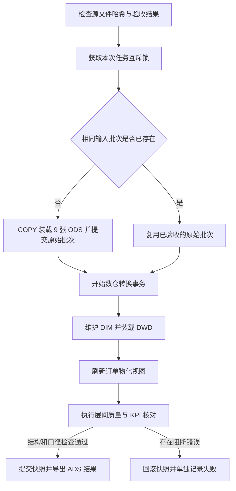

# 6 系统实现

本章说明电商交易与履约分析数仓系统已经完成的程序、数据库结构、运行流程和验证结果。系统使用真实 Olist 数据，以离线批处理方式完成原始数据接入、维度建模、主题汇总和 KPI 查询。当前已实现可运行的数仓后端和查询结果导出，交互可视化看板将在第七章继续完成。

本章各数值取自 `reports/system/` 中保存的实际运行结果，不以设计目标替代实测结果。数据库层与原始数据的独立验收基准逐项核对；一笔已送达订单缺失支付的源问题仍被显式保留。

## 6.1 开发工具和部署平台

### 6.1.1 开发工具

| 工具 | 实际版本或实现 | 用途 |
| --- | --- | --- |
| Python | 3.12.10 | 下载、文件验收、批次编排、事务控制、结果导出和集成测试 |
| PostgreSQL | 17.6 | 保存 ODS、DIM、DWD、DWS、ADS 和审计数据，执行转换 SQL |
| pandas | 3.0.1 | 原始数据剖析及字段质量检查 |
| psycopg | 3.2.10 | 数据库连接、流式 COPY、参数化查询及事务控制 |
| PostgreSQL 客户端工具 | 随 17.6 二进制包提供 | 数据库启停、pg_dump 备份、pg_restore 恢复验证 |
| Git 与 GitHub | 项目版本管理 | 保存代码、SQL、设计文档及去除敏感配置后的验证结果 |

依赖直接版本写入 `requirements.txt`，本次验证通过的完整依赖版本写入 `requirements-lock.txt`。项目使用独立虚拟环境，避免与其他课程项目的 Python 包相互影响。

初始设计提出 Python、PostgreSQL、dbt 和 Superset 的组合。实际第一版采用 Python 编排与版本化 SQL 管理转换，使组员能够直接查看每层表结构和处理语句，并完成本机复现。dbt 不属于本版已安装、已运行的组件；Superset 交互分析仍为后续工作。当前不是缺少计算过程的纯报表脚本，而是已经在 PostgreSQL 中建立持久化原始表、维度表、事实表和分析视图。

### 6.1.2 部署平台

本次验证环境为 Windows 11、Intel Core i7-14650HX、24 个逻辑处理器，系统报告物理内存为 16,873,545,728 字节，约 16 GB。PostgreSQL 使用 EDB 分发的 Windows 二进制文件，程序位于项目 `.runtime/`，数据目录位于 `.local/pgdata/`，未安装 Windows 系统服务。

数据库名为 `olist_dw`，本机连接地址为 `127.0.0.1:55432`，只监听回环地址。初始化脚本生成随机口令并写入被 Git 忽略的 `.env`。启动、状态和停止由 `scripts/local_postgres.py` 管理。另提供 `compose.yaml` 供具备 Docker 的组员使用；本次实际测试基于 Windows 独立数据库，Docker 方案尚未在本机执行验证。

读写开发账号用于 ETL；`olist_reader` 只读账号被授予 ADS 的 Schema 使用权限和查询权限。已实际验证该账号可以查询 KPI 概览，不能直接读取 `ods.orders`、`dwd.fact_order` 和 `audit.source_file`。只读密码保存在本机 `.local/reader.env`，不写入报告和仓库。

### 6.1.3 运行与验证

系统通过命令行提供 `init`、`run`、`verify`、`export` 和 `benchmark` 五个操作。`init` 安装版本化表结构；`run` 执行批处理；`verify` 与独立源数据基准核对；`export` 导出查询结果；`benchmark` 记录查询耗时及执行计划。

从空库进行的真实数据装载、转换和数据库核对耗时 **32.716 秒**；该计时包含 ODS 导入、转换及核对，不包含下载、建库前的文件哈希检查、最终 CSV 导出。复用 ODS 的另一次转换耗时 **25.366 秒**。空库和重跑的七类导出文件哈希一致。

七类查询分别预热一次后测量三次，结果如下，计时包含结果取回：

| 查询 | 三次中最大耗时 ms |
| --- | --- |
| KPI 总览 | 207.167 |
| 月度交易 | 166.349 |
| 地区履约 | 107.483 |
| 品类排名 | 165.002 |
| 卖家排名 | 151.584 |
| 配送与评分对比 | 72.662 |
| 评分分布 | 16.570 |

测试期间没有施加并发压力，因此这些数据说明课程演示规模下的查询响应，不代表高并发服务能力。原始记录见 `benchmark.json` 与 `query_plans.json`。

## 6.2 数据来源

### 6.2.1 来源与版本固定

数据来自 Olist 在 Kaggle 发布的 Brazilian E-Commerce Public Dataset by Olist，发布地址为 https://www.kaggle.com/datasets/olistbr/brazilian-ecommerce ，采用 CC BY-NC-SA 4.0 许可。本项目用于课程中的非商业研究与演示，保留发布者署名、来源和适用的相同许可声明。

2026 年 10 月 22 日通过发布接口下载完整 ZIP，并验证压缩包 CRC。未声称接口返回了数值版本号，而是以 ZIP SHA-256 与逐文件 SHA-256 固定本批数据。来源信息保存在 `data/source.json`，文件清单保存在 `data/manifest.csv`。ZIP 哈希为：

`967e41e04fc306fe604e2a693f488995a8b41e5047418f8a5c8e4abd6deca784`

### 6.2.2 数据文件

| 数据对象 | 原始行数 | 字段数 | 作用 |
| --- | --- | --- | --- |
| 订单 | 99,441 | 8 | 订单状态和生命周期时间 |
| 商品明细 | 112,650 | 7 | 商品、卖家、商品金额及运费 |
| 支付 | 103,886 | 5 | 支付方式、序号、分期次数和金额 |
| 评价 | 99,224 | 7 | 评分、评价标识及时间 |
| 客户 | 99,441 | 5 | 客户记录、唯一购买者和地区 |
| 商品 | 32,951 | 9 | 品类及商品物理属性 |
| 卖家 | 3,095 | 4 | 卖家标识与地区 |
| 地理位置 | 1,000,163 | 5 | 邮编前缀与坐标辅助映射 |
| 品类翻译 | 71 | 2 | 葡语品类与英文名称对应 |

下单时间范围为 2016-09-04 21:15:19 至 2018-10-17 17:30:18。客户记录对应 96,096 名不同购买者，不能把客户表行数直接称为独立用户数。2016 年 11 月未观察到订单记录，早期和末期部分月份稀疏；主趋势比较建议使用 2017 年 2 月至 2018 年 8 月，并披露完整时间覆盖情况。

### 6.2.3 数据验收结果

源验收包含 156 项检查，覆盖文件与字段契约、候选键、关联关系、数值、时间、缺失和汇总一致性。核心订单、客户、商品和卖家标识以及订单明细、支付复合键检查通过，关键事实关联没有孤立记录。

需要处理的主要情况包括：一笔已送达订单没有支付记录；547 笔订单存在多条评价；8 笔已送达订单没有实际到货时间；地理表有 261,831 条完全重复的多余记录；610 个商品缺少品类，13 个商品对应的两个原品类没有英文翻译。原始数据不作覆盖修改，各问题按明确规则进入后续层或异常记录。

## 6.3 ETL

### 6.3.1 执行流程



输入批次指纹由九个文件的名称与 SHA-256 计算。相同输入重复运行时复用 ODS，业务事实不会重复追加。任务通过 PostgreSQL 会话级 advisory lock 防止本项目并行执行相互干扰。

### 6.3.2 抽取和装载

`download_olist.py` 从公开发布接口下载文件，检查 ZIP 类型、CRC、九个成员文件名和既有文件一致性。原始 CSV 字节不改变。读取时使用 `utf-8-sig` 兼容带 BOM 的品类翻译文件，并用 CSV 解析器正确处理评价文本中的逗号、引号和换行。

装载使用 psycopg 的流式 `COPY FROM STDIN`，不逐行发送 INSERT。ODS 业务列均为 TEXT，同时加入 `batch_id`、`source_row_no` 和 `loaded_at`。来源记录号从首条数据记录开始计为 1，不包含表头，且不等同于可能包含多行文本的物理行号。原始值、空字符串和评价正文保留，便于追溯。

`audit.source_file` 登记来源、哈希、原始行数和下载时间。COPY 行数与清单不一致即回滚原始批次。原始层通过后独立提交，因此后续转换失败时可以保留已核验的输入，再次运行无需重复下载或装载。

### 6.3.3 数据清洗与转换

日期转为不带时区的时间戳，并生成连续日期维度；不把来源当地钟面时间强行转换成中国时间。金额转为 `NUMERIC(18,2)`。城市去除首尾空白、合并连续空白并转小写，州代码转大写；邮编前缀在维度层补为五位字符串。

客户维度保留 `customer_id` 与 `customer_unique_id` 两种标识。商品维度把翻译合并为属性，翻译缺失时保留原品类，品类缺失时归入未知。维度使用 Type 1 更新，代理键在重跑时保持既有映射。维度技术未知成员不作为真实交易计数。

地理辅助映射先排除不在近似巴西包围盒内的坐标，再对邮编与坐标组合去重，按邮编取经纬度中位数。包围盒是异常筛查规则，不是国界判定；客户、卖家地区仍来自其来源表的州和城市。该辅助维度可用于后续地图，但不参与订单数量放大的连接。

订单事实每单一行，明细事实每个订单明细序号一行，支付事实每个支付序号一行。评价先按每订单的回复时间、创建时间、评价 ID 和来源记录号降序排序，NULL 放在最后，选取一条代表评价。选择发生在评分有效性判断前。原始 99,224 条评价选择后形成 98,673 条订单代表评价；未被选择的记录仍保留在 ODS。

### 6.3.4 防止多表关联放大

商品明细与支付都可能在一个订单下出现多行。系统分别将明细和支付按订单聚合，再连接订单事实和一行一单的代表评价，形成 `dws.order_wide`。不直接连接两张多行子事实后求和。

```sql
WITH item_sum AS (
  SELECT order_id, SUM(price) item_amount,
         SUM(freight_value) freight_amount
  FROM dwd.fact_order_item GROUP BY order_id
), payment_sum AS (
  SELECT order_id, SUM(payment_value) payment_amount
  FROM dwd.fact_payment GROUP BY order_id
)
SELECT o.order_id, i.item_amount, i.freight_amount, p.payment_amount
FROM dwd.fact_order o
LEFT JOIN item_sum i USING (order_id)
LEFT JOIN payment_sum p USING (order_id);
```

订单宽表使用物化视图，保留 99,441 行，并在订单标识上建立唯一索引。批处理完成明细转换后在事务内刷新，减少看板查询时反复聚合多个子事实的成本。原始表与维度在大批量写入后执行 ANALYZE，使优化器获得实际统计信息。

### 6.3.5 质量规则与失败处理

数据库核对共 51 项，覆盖九张 ODS 行数、四张事实表粒度、六组金额、父子事实维度一致性、日期键、KPI 基准和汇总可加性。当前 50 项通过，1 项为已知缺失支付的告警；结构、金额加工和指标计算没有未通过的阻断项。

源数据中的支付完整性失败继续记录在审计结果中。默认策略只发布“已记录支付金额”，并同时返回覆盖率；“完整支付金额”返回 NULL。这个规则是指标可用范围的明确调整，不是把源问题改标为正常。使用 `--strict-payment` 可将其提升为整个转换的阻断项。

所有 DWD 替换、维度维护、宽表刷新和转换质量检查位于同一事务。中途失败时，前一次已提交快照保持不变，失败日志在回滚后的新事务中写入。已经通过故障注入验证：转换后主动抛出异常，七类导出结果哈希仍与原快照相同。

`audit.load_batch` 记录原始批次，`audit.pipeline_run` 记录每次执行，`audit.quality_result` 记录规则结果，`audit.rejected_record` 记录需要区别处理的订单及动作。该表中的缺失支付订单仍保留业务事实；“异常记录”并不意味着整笔订单已被物理删除。

## 6.4 数据分层

### 6.4.1 各层职责

| 层次 | 实际对象 | 职责 |
| --- | --- | --- |
| ODS | 9 张原始表 | 原值、批次、来源记录号，不提前丢弃异常 |
| DIM | 日期、地区、客户、商品、卖家、支付方式、邮编坐标共 7 张维表 | 一致性维度及辅助地理映射 |
| DWD | 订单、订单明细、支付、代表评价共 4 张事实表 | 明确事实粒度、业务类型、主外键 |
| DWS | 1 个订单物化视图、6 个汇总视图 | 一行一单宽表和时间、地区、品类、卖家、评分主题汇总 |
| ADS | 11 个应用视图 | 总览、日/月交易、地区履约、排名、评价与支付质量查询 |
| AUDIT | 原始批次、文件、执行、规则、异常、版本共 6 张表 | 追踪运行、质量、版本和失败原因 |

共实现 26 张持久表、17 个普通视图和 1 个物化视图。DWS 日地区汇总保存分子和分母，ADS 向上汇总时重新计算比率。全局购买人数直接根据客户唯一标识去重，不由地区人数求和。

### 6.4.2 依赖与物理管理

`sql/01_warehouse_schema.sql` 定义基础表及日级视图，`sql/02_runtime_and_marts.sql` 定义版本、运行审计、辅助维度和扩展主题，`sql/03_transform.sql` 定义装载顺序。CLI 对初始化文件计算 DDL 哈希，保存于 `audit.schema_version`。已安装版本与文件不一致时停止，要求显式迁移或选择新的开发空库，不自动删除已有数据库对象。

ODS 到 DIM、DWD 的处理采用全量源快照。当前数据没有可靠更新时间字段，因此没有声称实现真实实时采集或完整的历史变更增量捕获。相同输入的原始批次可复用，事实快照在事务内替换；不同输入版本应重新验收和建立新批次。

事实主键、维度业务键、外键与金额 CHECK 约束在数据库中实际生效。订单日期与地区、明细商品与日期、卖家与日期等建立索引。当前规模不进行分区；物化订单宽表及统计信息已满足单机课程演示性能。

### 6.4.3 可复现与运维验证

集成测试通过 14 项断言，覆盖支付缺失保留、完整支付金额为 NULL、评价单订单唯一、缺失配送时间排除、自然日边界、零分母、原始批次复用、重复运行输出一致、转换失败回滚及严格支付策略。测试数据来自真实源文件，边界测试仅使用临时 SQL 表达式，没有插入虚构交易事实。

空库测试在专门创建的测试数据库中完成初始化、九表导入、分层转换和指标导出，与既有系统的输出哈希一致；验证后删除该测试数据库。原始项目数据库保持不变。

备份采用 `pg_dump` 的 custom 格式，并在新建测试数据库中用 `pg_restore` 恢复。验证恢复后的 KPI 概览和原始地理表行数，再删除测试库。备份仅保存在本机被忽略的目录，不包含登录角色密码；跨环境恢复需重新创建账号和权限。验证证据见 `backup_restore.json`。

## 6.5 KPI

### 6.5.1 统一口径和实现

交易集合为最终状态 `delivered` 的订单，按下单时间归属统计期间。商品金额、运费和已记录支付金额分别计算。配送样本要求下单与实际到货时间有效且顺序正常；逾期样本还要求预计到货日期有效。评分使用按约定规则选出的代表评价。

| KPI | 实现口径 | 本次数据库结果 |
| --- | --- | --- |
| 全部订单数 | 全状态订单事实行数 | 99,441 |
| 已送达订单数 | delivered 订单数 | 96,478 |
| 商品销售金额 | 已送达明细 SUM(price)，不含运费 | 13,221,498.11 BRL |
| 运费 | 已送达明细 SUM(freight_value) | 2,198,275.64 BRL |
| 已记录支付金额 | 已送达订单实际存在的支付记录之和 | 15,422,461.77 BRL |
| 完整支付金额 | 仅支付覆盖完整时返回金额 | NULL，缺失 1 单 |
| 支付订单覆盖率 | 有支付记录的已送达订单 / 已送达订单 | 99.998963% |
| 客单价 | 商品销售金额 / 已送达订单数 | 137.0416 BRL/笔 |
| 购买用户数 | 已送达订单客户唯一标识去重 | 93,358 |
| 平均配送耗时 | 96,470 笔有效订单的配送总秒数 / 样本数 / 86,400 | 12.5582 天 |
| 逾期率 | 6,534 / 96,470，按自然日比较 | 6.7731% |
| 已送达平均评分 | 95,832 笔有效代表评价的评分均值 | 4.155908 分 |
| 已送达低分率 | 12,273 / 95,832，低分为 1 或 2 | 12.8068% |
| 逾期组低分率 | 逾期且有评价的 6,381 笔订单 | 62.4197% |
| 未逾期组低分率 | 未逾期且有评价的 89,443 笔订单 | 9.2674% |

最后两项仅反映样本的统计关联，不能据此断言配送延迟导致低分。月度或地区结果应同时显示样本数，避免只看比例。

### 6.5.2 指标查询与输出

`ads.kpi_overview` 提供全局指标；`ads.trade_month` 提供月度交易；`ads.fulfillment_state` 提供客户州级履约；`ads.category_ranking` 和 `ads.seller_ranking` 提供交易结构；`ads.delivery_review_comparison` 和 `ads.review_distribution` 提供评价分析。`ads.payment_quality` 用于追溯支付缺失和记录差额。

```sql
SELECT * FROM ads.kpi_overview;
SELECT * FROM ads.trade_month ORDER BY year_no, month_no;
SELECT * FROM ads.fulfillment_state ORDER BY late_rate DESC;
SELECT * FROM ads.delivery_review_comparison ORDER BY is_late;
```

导出 CSV 保留数值原始精度，展示时再四舍五入；比例为 0 到 1，NULL 导出为空白，不能在 Excel 或看板中自动填成零。品类和卖家指标使用商品明细金额，未将支付金额无依据地分摊到商品或卖家。一个订单可跨多个品类或卖家，因此这些分组订单数不应相加为全局订单数。

### 6.5.3 实现范围与后续衔接

第六章对应的数据库、接入、转换、分层、KPI 及其验证已经具备可运行实现。下一步基于 ADS 视图接入交互可视化工具，完成时间和地区筛选、品类或卖家排名下钻，撰写第七章分析结论并录制系统演示。Superset 页面、最终 Word 排版、PPT 与答辩录屏不在本章中宣称已完成。

## 本章实现证据

- `reports/system/fresh_database.json`：空库全量处理、核对与输出一致性。
- `reports/system/last_run.json`、`verification.json`：实际数据库 KPI、规则结果与版本信息。
- `reports/system/integration_tests.json`：14 项集成断言。
- `reports/system/benchmark.json`、`query_plans.json`：查询耗时与执行计划。
- `reports/system/reader_permissions.json`、`backup_restore.json`：只读权限和恢复验证。
- `scripts/warehouse.py` 与 `sql/`：可执行入口与实现代码。
