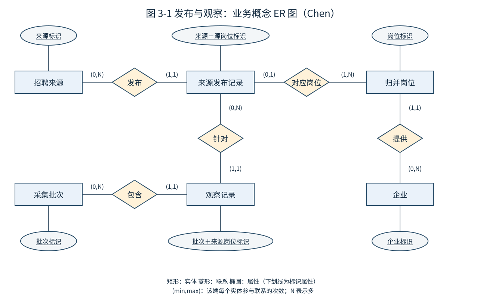
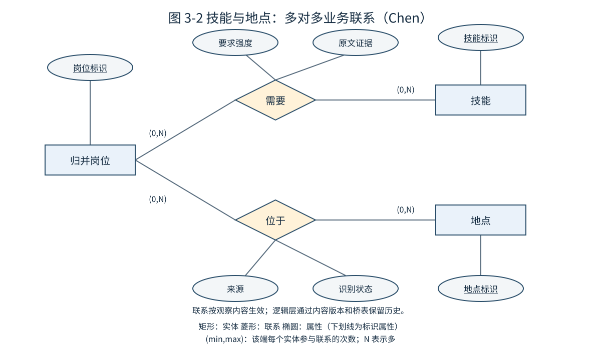

# 3. 概念设计

[设计目录](README.md) · 上一章：[需求分析](02_需求分析.md) · 下一章：[逻辑设计](04_逻辑设计.md)

## 3.1 建模层次与业务过程

概念模型描述“业务中存在什么、彼此有什么关系”，不预先写数据库类型、索引或物化策略。本项目分三个过程：公开岗位发布、采集观察、岗位需求分析。来源网站上的一条发布记录不必等于一个独立岗位；每日对它的观察也不是又发生一次发布。

按 Kimball 方法，后续重点事实是“一次批次中的来源岗位观察”和“某分析版本下某日的归并岗位快照”。来源发布是业务实体；来源没有可靠发布事件时，不凭空建立真实招聘事件流水。

## 3.2 Chen 概念 ER 图

图 3-1 使用矩形表示实体、菱形表示联系、椭圆表示属性，下划线表示标识属性。边旁的 `(最小,最大)` 表示该端每个实体实例可参与多少次联系。例如来源发布记录的“对应岗位”端为 `(0,1)`：综合简章或尚未归并记录可以暂不对应核心岗位；归并完成后的有效单岗记录必须对应一个岗位。

图 3-2 中岗位与技能、地点都是多对多联系，不能在逻辑层仅放一个文本串后就按拆分行数统计岗位。“需要”联系具有要求强度和原文证据；地点联系具有来源与识别状态。这两类联系将在逻辑层转为桥表。

图示仅列关键标识属性，完整业务属性和联系如下。Chen 适用于本章业务概念；第 4 章的事实/维度关系使用关系模型表示法，二者不混用。

## 3.3 实体字典

| 实体 | 业务含义与标识 | 主要业务属性 | 关键限制 |
| --- | --- | --- | --- |
| 招聘来源 | 一个批准的网站/公开查询来源，source_code | 名称、官网、访问规则、采集范围版本 | 来源不等于雇主；聚合平台可发布多个企业岗位 |
| 来源发布记录 | `(source_code, source_job_id)` 标识的一条页面/接口记录 | 标题、原始企业、地点、职责、要求、招聘类型、源时间 | 可被更新、转载，也可能是综合简章 |
| 归并岗位 | 本系统维护的 job_key 标识的分析对象 | 主类别、业务归属、归并状态 | ID 是分析身份，不是网站 ID；保守归并，未知重复风险需披露 |
| 企业 | 经规则可识别的招聘企业/品牌，company_key | 原名、规范名、别名、用工主体核实状态 | 不凭品牌名称断言法律主体；派遣关系单独标记 |
| 采集批次 | 一次独立来源扫描，batch_id | 开始/结束、查询范围、覆盖状态、文件清单 | 失败或部分批次不能证明岗位消失 |
| 观察记录 | `(batch_id, source_code, source_job_id)` | 观察时间、当次原文、解析版本、质量状态 | 一个批次同一来源 ID 至多一条规范观察 |
| 地点 | 规范地区 location_key | 国家、省、市、行政编码/版本、原文映射 | 无法识别时未知，不能随意取企业总部 |
| 技能 | 受控词典中的 skill_key | 标准名、别名、类别、词典版本 | “SQL”和“MySQL”不可默认互相替代；证据与语境保留 |

日期、学历、经验、招聘类型、岗位类别是分析分类属性，将在逻辑设计中组织为共享维度；不是把每个属性都人为画成业务实体。

## 3.4 联系、基数与业务规则

| 联系 | 基数/参与约束 | 业务规则 |
| --- | --- | --- |
| 来源发布来源记录 | 来源 0..N；记录 1..1 | 同一来源 ID 稳定识别，不跨来源比较裸 ID |
| 来源记录对应归并岗位 | 记录 0..1；岗位 1..N | 仅已接受的单岗记录映射；模糊候选先保持不同身份 |
| 企业提供岗位 | 企业 0..N；岗位 1..1 | 暂无法规范企业的岗位指向“未知企业”技术成员；原文不可丢失 |
| 批次包含观察 | 批次 0..N；观察 1..1 | 批次可以失败且没有有效观察，不能删除审计记录 |
| 观察针对来源记录 | 记录 0..N；观察 1..1 | 重复采集是新观察；同一批次内重复请求不产生重复事实 |
| 岗位关联技能 | 岗位 0..N；技能 0..N | 缺失正文≠不要求技能；联系强度区分必需/优先/提及/不确定 |
| 岗位关联地点 | 岗位 0..N；地点 0..N | 多地点有效；缺失时保留未知，不复制岗位身份 |

岗位属性随观察改变。概念图的技能/地点关系表示某次观察有效的业务联系，并不承诺永恒不变；逻辑实现必须绑定来源内容版本或每日代表版本，不能将今天的技能倒填到过去。

## 3.5 业务过程与事实粒度

| 过程 | 粒度声明 | 事实类型 | 度量 |
| --- | --- | --- | --- |
| 批次采集 | 一次来源扫描运行 | 运行事务事实 | 请求数、成功数、唯一 ID 数、耗时、失败数 |
| 来源岗位观察 | 一批次内一条来源岗位 | 无金额交易的观察事实 | 观察计数 1、正文是否有效、字段缺失标记 |
| 每日归并岗位分析 | 一个发布版本×一个日期×一个 job_key | 周期快照事实 | 岗位计数 1、覆盖/冲突标记、首次发现/变化标记 |

招聘人数不作为跨岗位可加度量；快照岗位计数对日期不可加；“技能数”和“地点数”只描述多值属性，不能替代岗位数。

## 3.6 总线矩阵

| 事实过程 | 日期/时间 | 来源 | 企业 | 岗位身份 | 来源内容版本 | 地点 | 主类别 | 学历/经验 | 招聘类型 | 技能 |
| --- | --- | --- | --- | --- | --- | --- | --- | --- | --- | --- |
| 采集运行 | 运行开始/结束 | 直接 | — | — | — | — | — | — | — | — |
| 来源观察 | 观察时间/源时间 | 直接 | 经内容版本 | 经版本化归并 | 直接 | 经版本桥表 | 经版本 | 经版本 | 经版本 | 经版本桥表 |
| 每日岗位快照 | 分析日期 | 代表来源＋来源证据集合 | 直接 | 直接 | 代表版本 | 经代表版本桥表 | 直接 | 直接 | 直接 | 经代表版本桥表 |

共享维度保证跨事实口径一致。日期在观察时间、来源更新时间等场景中扮演不同角色，不能把来源更新日期混作分析快照日期。技术键、维度历史、桥表和发布版本详见下一章。

## 3.7 概念设计检查结论

模型允许转载、多来源、字段未知和多地点/技能，能够解释真实样本问题；没有假设拿到了投递或录用数据。核心业务联系已明确，但归并准确性仍需人工抽检，未来扩展来源必须遵守相同实体定义。
