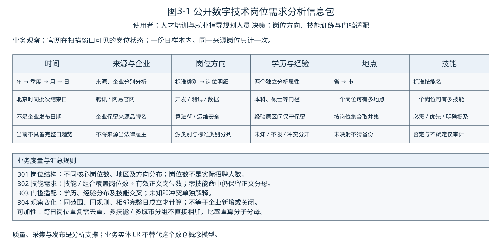

# 3 概念设计

> 当前运行数据已切换到腾讯、网易、小米、京东四来源1579岗/1556核心岗；版本与验收见[四来源扩量联调](../verification/四来源扩量联调.md)。本章涉及200岗的数量为历史小批设计验证；正式报告按用户要求暂缓更新。

[设计目录](README.md) · [上一章](02_需求分析.md) · [下一章](04_逻辑设计.md)

## 3.1 分析信息包

本章用信息包表达“围绕什么主题、从哪些角度、分析哪些度量”，不以实体关系数据库设计替代数仓概念结构。

主题为公开数字技术岗位需求；使用者是人才培训与就业指导的规划人员。核心业务观察为官网在扫描窗口内可见的岗位状态，而非投递、录用或企业实际招聘事件。

## 3.2 维度与层次

| 分析维度 | 属性/层次 | 业务解释与限制 |
| --- | --- | --- |
| 分析日期 | 年→季度→月→日 | 北京时间批次结束日；不等于发布日期；层次可展开不证明已有连续趋势 |
| 来源 | 来源代码、名称 | 腾讯、网易；不建立来源必然等于雇主的层次 |
| 企业 | 来源企业名称、主体核实状态 | 当前企业名称保守保留，不能宣称法律主体已核实 |
| 岗位方向 | 标准类别→岗位明细 | 五类核心方向；原类别另存；自动初分类按第 2 章规则 |
| 学历和经验 | 两个独立分类属性 | 不人为构成同一上下级层次；未知、不限、冲突分别保留 |
| 招聘类型 | 原值及已核实的规范类型 | 网易0全职/1实习/2派遣已核实；腾讯仍未释义，不能作社招/校招横比 |
| 地点 | 省→市；一岗可多地点 | 地点映射保守，未映射不猜省；冲突单列 |
| 技能 | 标准技能名；一岗可多技能 | 匹配证据带正文位置与要求强度；否定/不确定不进有效统计 |

## 3.3 度量与业务解释

主要度量为核心来源岗位数、有效正文岗位数、技能/组合覆盖岗位数及相应占比。它们分别回答方向规模、可用文本覆盖、技能训练重点及组合需求。岗位数不是招聘人数；技能岗位数不是词频或证据条数。

岗位日状态随日期反复出现，因此岗位计数对时间是半可加的：单日互斥类别可加，跨日独立岗位数需按稳定身份去重。城市和技能均多值，分别分组可用，交叉展开后必须回到岗位集合求计数。正文和来源质量是解释结果可信程度的支撑度量。

## 3.4 概念模型到逻辑模型

| 信息包内容 | 逻辑实现方向 | 对应需求 |
| --- | --- | --- |
| 一个分析日可见的岗位状态 | 岗位日状态快照事实 | B01—B04 |
| 单岗的来源、企业、类别与门槛 | 事实直接引用相应维度 | B01、B03 |
| 多技能、多地点 | 事实与维度之间使用去重桥表 | B01、B02 |
| 时间和正文历史 | 日期维度、来源观察及内容版本 | B04、可追溯 |
| 原始语义与质量限制 | 原文引用、冲突/范围标记、构建审计 | S01 |

本章不先写 SQL 类型、索引或实际代理键，这些由第 4、5 章展开。下一章在事实表上明确“一行代表什么”，再选取维度和事实。

## 3.5 业务规则辅助材料

原 Chen 图仅用于解释发布记录、采集观察、技能及地点的实体联系，不作为本章数仓概念模型的主图。保留其可维护源文件：[发布与观察](figures/03_01_发布与观察.svg)、[技能与地点](figures/03_02_技能与地点.svg)。其中“归并岗位”表达未来有证据归并的业务关系，不是当前一对一来源身份已经具备的能力。
