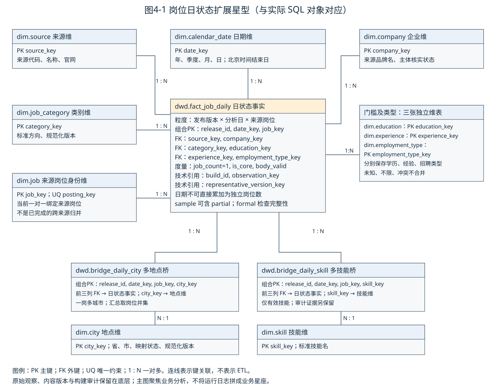
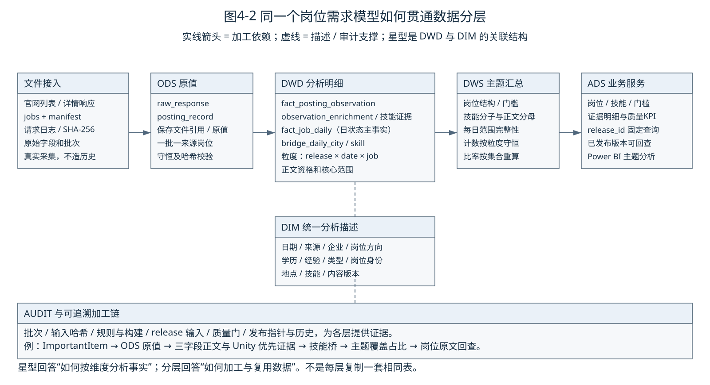

# 4 逻辑设计

> 当前运行数据已切换到腾讯、网易、小米、京东四来源1579岗/1556核心岗；版本与验收见[四来源扩量联调](../verification/四来源扩量联调.md)。本章涉及200岗的数量为历史小批设计验证；正式报告按用户要求暂缓更新。

[设计目录](README.md) · [上一章](03_概念设计.md) · [下一章](05_物理设计.md)

## 4.1 先业务过程再事实表

采用 Kimball 的业务过程→声明粒度→识别维度→识别事实四步法。数据可行性和需求先于模型，字段来源与转换随后落实；参照第 4 章课程案例 PDF 第 23—28、56 页。

| 步骤 | 本项目决定 | 为何这样决定 |
| --- | --- | --- |
| 业务过程 | 公开岗位的可见状态观察 | 只有官网观察数据，没有企业发布、录用等真实业务流水 |
| 声明粒度 | 固定发布版本×北京时间批次结束日×来源岗位身份 | 同岗跨日可重复出现；同日每来源只选一个批次，避免重复扫描放大 |
| 识别维度 | 日期、来源、企业、标准类别、学历、经验、招聘类型、岗位身份；城市与技能为多值 | 支撑方向、地区、门槛与技能的交叉分析 |
| 识别事实 | job_count=1、is_core、body_valid；技能/城市桥中的成员资格 | 支持岗位计数、正文分母与去重覆盖；不添加缺少来源依据的招聘人数或金额 |

底层 `fact_posting_observation` 为批次×来源身份的无事实型观察明细。分析主事实 `fact_job_daily` 为岗位日状态快照：数据完整时形成批准范围快照，partial 时明确为样本状态切片，不承诺范围内无遗漏。

## 4.2 模型选型与实际扩展星型

**当前主分析模型选择扩展星型**：日状态事实直接关联描述维度，城市、技能用桥表支持多值。省、市保留同一地点维度，不全面雪花化。未来多个有明确业务需求的分析事实共享维度时，可扩展为星座；采集日志和发布审计的数量本身不作为宣称星座完整实现的依据。

图内标识实际 `schema.table`；连线表示键关联并标一对多，箭头不表示 ETL。复合键中的多个 PK 字段共同唯一，不是各自唯一。技能和城市桥不能同时展开后直接 SUM 岗位计数；需分别取岗位集合再交集或并集。

## 4.3 事实、桥表与技术版本

| 对象 | 一行代表什么 | 唯一性/度量 |
| --- | --- | --- |
| `dwd.fact_posting_observation` | 一个批次对一条来源身份的观察 | UNIQUE(batch_id,posting_key)；观察计数，不当企业新发布 |
| `dwd.fact_job_daily` | 一个发布版本内，某分析日的一条来源岗位状态 | PK(release_id,date_key,job_key)；job_count=1、is_core、body_valid |
| `dwd.bridge_daily_city` | 某日状态对一个规范城市的成员资格 | PK(release_id,date_key,job_key,city_key)；不复制岗位身份 |
| `dwd.bridge_daily_skill` | 某日状态对一个有效标准技能的成员资格 | PK(release_id,date_key,job_key,skill_key)；已按岗位技能去重 |
| `dwd.job_qualification_evidence` | 一发布×一日×一来源岗位的学历/经验派生 | 与日事实复合FK；规则、必需/优先、不确定、逐字原文和位置 |
| `dwd.bridge_version_skill` | 单来源提取构建内，内容版本×技能×强度×有效性的证据组 | 留存原文位置；行数不等于岗位技能对数 |

`job_key` 当前由 `dim.job` 一对一绑定 `posting_key`，`mapping_version=source-identity-only-1.0`。不同官网即使标题相同仍分别计数，不声称已归并成独立招聘机会。跨源合并是未来单独的业务规则变更，需要证据与窗口重建。

| 标识 | 含义 | 不能混用为 |
| --- | --- | --- |
| batch_id | 一次真实来源扫描 | 每次运行程序的时间 |
| observation_key | 批次内来源观察 | 跨日稳定岗位身份 |
| version_key | 来源正文内容的一个观察有效期版本 | 技能规则版本或批次 |
| build_id | 单来源批次的技能、范围及冲突分析构建 | 整组快照的发布号 |
| release_id | 固定一组单来源构建、规范化及映射版本的分析发布 | 单来源技能构建 |
| job_key | 当前保守的来源岗位分析身份 | 已验证的跨来源归并身份 |

内容 A→B→A 建三个有效期，原始观察不覆盖。`dim.posting_version` 表示观察到的有效期，不等于企业真实生效期。迟到或同时间冲突需要显式重建，拒绝静默改历史。

## 4.4 维度一致性及映射

统一维度用于复用分析成员与属性语义；图文和代码对应、转换符合源业务语义是另外两项一致性要求。

- 日期用 `dim.calendar_date`；观察日与批次结束日角色分开。分析日期层次为年、季度、月、日。
- `dim.source` 是来源，`dim.company` 是来源企业品牌名，不假定来源等于法律雇主。
- 类别、学历、经验与招聘类型采用第 2 章规则，原值另存；未知、不限、冲突不互换。小批源类别明确标 `source_category_group`，标准类别只称 `category_group`。
- `dim.city` 保留省市及 mapping_status，局部映射字典不是全国行政区划普查；`dim.location` 是历史原地点字典，两者用途不同。
- 本实现未知维成员采用显式“未知”业务成员并由数据库分配代理键，不要求固定 0。关联事实必须非空并通过外键。
- 维度成员变化保留旧行，类别/城市带 normalization_version，完整快照带规则和映射版本。经验原区间不伪装成更精细区间。

## 4.5 星型与数据分层的关系

星型定义分析数据怎样关联；分层定义数据怎样加工和复用。它们不是同一层级的替代方案。

| 层/支撑 | 实际对象与职责 | 下游用途 |
| --- | --- | --- |
| 文件接入 | 公开响应、JSONL、清单、日志 | 原始证据和可重建输入 |
| ODS | `raw_response`、`posting_record` | 原值落地、批次与文件追溯 |
| DWD + DIM | 观察/版本、范围扩展、技能证据；岗位日状态与维度/桥表 | 主星型模型，保持细粒度与历史 |
| DWS | `release_daily_summary`、岗位结构/门槛与技能主题汇总；小批 `cd_scope_summary` 等 | 独立复用的计数与分母 |
| ADS | `release_*` 与固定小批 `cd_*` | 业务指标、明细与报表服务，按版本查询 |
| AUDIT | 批次、规则构建、输入选择、发布指针/历史 | 血缘、质量和失败控制，不充当招聘事件事实 |

DDS 是课堂案例的维度存储视角；本项目的 DWD/DIM 及其汇总接口实现分析用途，不能将课堂 NDS/DDS 与四层机械一一对应。

## 4.6 日选择、完整性与发布

sample 从技术验收通过的输入中按每来源×结束日选择最新批次，可含 partial，明确显示样本；formal 选择该日最新 complete 批次，必须覆盖两个批准来源。后来的 partial 不替换 formal 的完整批次。查询范围、提取、正文、分类和映射版本不能混算可比窗口。

只有相邻两个真实日均完整才计算新增观察和内容变化；缺源、partial、无基线时返回 NULL。持续未观察需两个合格日，不叫确认关闭。第一日为基线，不当新增招聘。

新 release 验证后用短事务切换 `publication_pointer(channel)`；旧发布可查询。ADS 发布接口允许读取曾发布的历史版本，**查询必须固定 release_id**，不把多个发布版本简单累计。Power BI 准备刷新时选定一次版本，所有表固定该版本，刷新中不反复读取移动指针。

## 4.7 业务到实现的追踪

| 需求 | 事实/属性 | 主题汇总/服务 | 展示 |
| --- | --- | --- | --- |
| B01 结构 | 日状态、类别、城市桥、日期/来源 | 岗位结构主题、城市与岗位明细接口 | 岗位需求多维分析 |
| B02 技能 | 有效正文、技能桥和证据 | 技能主题及组合接口 | 技能与组合、证据页 |
| B03 门槛 | 日状态、学历/经验、技能桥 | 门槛主题及明细接口 | 门槛筛选和交叉分析 |
| B04 变化 | 稳定岗位身份、版本、日覆盖 | 日汇总及 `release_observed_change` | 条件不满足则说明不可比较 |
| S01 可信度 | 批次、原始文件、构建与引用 | `cd_quality_kpi`、验证视图 | 项目质量 KPI、构建与质量 |
