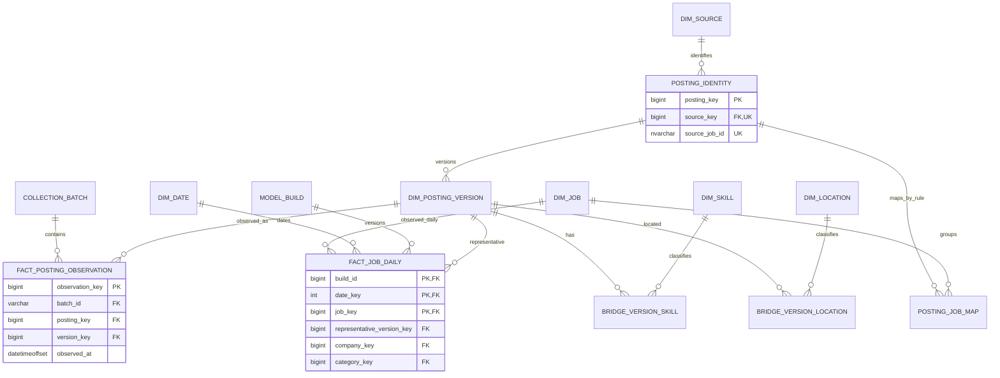

# 4. 逻辑设计

[设计目录](README.md) · 上一章：[概念设计](03_概念设计.md) · 下一章：[物理设计](05_物理设计.md)

## 4.1 分层架构与职责

图 4-1：主数据流为 ODS→DWD→DWS→ADS；DIM 作为一致性维度支持事实，AUDIT 支撑全链路。原始文件不是额外业务分层；其作用是保留可验证输入。

| 层 | 逻辑对象 | 职责及粒度 |
| --- | --- | --- |
| ODS | `raw_response`、`posting_record` | 响应文件引用/哈希；一批一来源岗位的原字段 JSON，保留错误原值 |
| DIM | 日期、来源、企业、地点、主类别、学历、经验、招聘类型、技能、岗位身份、来源内容版本 | 共享编码、别名与未知成员；内容版本跟踪观察到的变化 |
| DWD | `fact_collection_run`、`fact_posting_observation`、`fact_job_daily` | 运行、来源观察、每日归并快照三种粒度分开 |
| DWD 关联 | `posting_job_map`、`bridge_version_location`、`bridge_version_skill`、`job_daily_evidence` | 归并及多值关系，保留版本、证据与选择依据 |
| DWS | `job_day_category`、`job_day_city`、`skill_day_category`、`observation_change_day` | 可复用计数与分子分母；带 build_id 和分析日期 |
| ADS | `job_overview`、`job_distribution`、`skill_demand`、`skill_pair`、`observed_change`、`quality_coverage` | 统一查询口径，供图表和明细下钻；仅暴露已发布 build |
| AUDIT | `collection_batch`、`quality_issue`、`rule_version`、`model_build`、`build_batch`、`publication_pointer` | 批次、错误、规则、构建及发布控制，不冒充招聘事实 |

## 4.2 核心关系模型

逻辑模型不依赖特定数据库；本版在 SQL Server 中使用 T-SQL 和对应类型实现，由 dbt 管理转换依赖与测试。Power BI 使用 Import 模式，按固定发布 build_id 刷新，具体规则见第 5 章。

物理命名统一使用 `schema.table`：本章 `dim_posting_version` 对应 `dim.posting_version`，其他 `dim_*` 同理；`posting_identity` 放在 DIM。逻辑图大写标签仅用于阅读。

图 4-2：逻辑键与基数关系图，使用乌鸦脚关系表达，与第 3 章 Chen 概念图用途不同。`source_key + source_job_id` 为**组合唯一键**，不是两列分别唯一；快照的三个 PK 字段也为组合主键。为保持可读性，企业、学历、经验等维度引用在字段表中补全。

## 4.3 一致性维度与历史策略

| 对象 | 键与主要属性 | 历史处理 |
| --- | --- | --- |
| `dim_date` | date_key=YYYYMMDD；日期、年、月、日、周 | 中国时区分析日历；来源时间仍保留原时区/原值 |
| `dim_source` | source_key、source_code 唯一、官网、来源等级 | 范围和优先级由 rule_version 固定，不直接改历史 |
| `dim_company` | company_key、规范名、原名映射、主体核实状态 | 别名人工维护；品牌与法律主体不强行等同 |
| `dim_location` | location_key、行政编码、编码版本、省/市、层级 | 行政区划字典有版本；缺失用未知成员 |
| `dim_job_category` | category_key、主类别、分类规则版本 | 一个岗位一个主类别；歧义单独标记 |
| `dim_education/experience/employment_type` | 代理键、代码、排序和原值映射 | 未知、不限、冲突分别编码；原值留在内容版本 |
| `dim_skill` | skill_key、标准名、类别、别名/词典版本 | 不把不同技能随意合并；词典变更生成新规则版本 |
| `dim_job` | job_key、稳定内部身份、创建原因 | 不在此覆盖每日标题和要求；合并拆分通过版本化映射重算 |
| `posting_identity` | posting_key；source_key＋source_job_id 唯一 | 来源记录身份稳定；综合简章同样可登记身份但不映入核心岗位 |
| `dim_posting_version` | version_key、posting_key、content_hash、规范属性、原文引用、valid_from_observed/valid_to_observed | Type 2 的观察有效期 `[from,to)`；表示系统观察到的版本，不是实际业务生效时间 |

内容哈希仅包含职位相关字段，不包含采集时间、页面广告或推荐岗位。相同内容继续引用现有版本；内容 A→B→A 必须产生三个有效期区间，不能因为哈希相同把最后一个 A 复用为最早版本。区间以观察时间排列，同一时刻并列时按批次/来源行顺序确定；保留原观察以便重建。

## 4.4 事实及桥表的逻辑字段

| 对象 | 粒度/业务唯一性 | 字段与引用 |
| --- | --- | --- |
| `fact_collection_run` | 一次批次运行 | batch_id、source_key、scope_version、起止时间、请求/失败/唯一记录数、覆盖状态；与审计批次一对一 |
| `fact_posting_observation` | `(batch_id, posting_key)` 唯一 | observation_key、version_key、observed_at、原始引用、正文有效性、解析状态；不直接按行求独立岗位数 |
| `posting_job_map` | `(mapping_version, posting_key)` 唯一 | job_key、归并方法、证据、审核状态；同版本一来源身份至多映一个岗位 |
| `fact_job_daily` | `(build_id, date_key, job_key)` | 代表 version_key、source_key、company/category/education/experience/employment_type 键、正文有效性、冲突与首次发现标记；job_count=1 |
| `job_daily_evidence` | `(build_id,date_key,job_key,observation_key)` | 将每日岗位回连全部成员观察；不可当快照计数表 |
| `bridge_version_location` | `(version_key,location_key,normalization_version)` | 原始地点、识别置信/方法；同版本重复地点只保留一个 |
| `bridge_version_skill` | `(version_key,skill_key,extractor_version,requirement_level)` | 证据位置和片段数组、语境标签；查询同岗位技能需 DISTINCT |

版本维度中的原值不在每层复制成多个可编辑副本。事实表复制的规范维度键必须等于代表版本对应值，使用质量检查保证一致。技能和地点通过**代表内容版本**关联，不将所有转载来源技能取并集，从而避免把矛盾描述拼成新岗位。

## 4.5 归并与技能规则

来源内以自然键识别，不能按标题去重。跨源归并先使用明确引用的同一原始官网岗位 ID/URL；其次只生成候选：规范企业、标题、地点、招聘类型、正文相似度。第二类必须人工审核确认后合并；不同岗位同名时维持独立。无明确证据的记录不强行归并。

同一 mapping_version 内映射不可变。修改归并/分类/技能规则时生成新的 build，使用同一新规则重算整个可比日期窗口；旧发布版本和原始观察保留。不得将今天用新规则计算的数量与昨天旧规则结果直接比较。

技能处理先分离职责与任职要求，再做标准词及别名匹配、大小写和边界识别、否定/优先语境标记。只对明确结果发布；不确定项进入审核。不要求用大模型代替可解释规则；若未来增加模型提取，必须记录模型版本并进行相同留出集验证，不能补造源文没有的要求。

## 4.6 日快照、完整性与变化

每个来源每个分析日只选择最新合格完整批次，选择结果固定写入 `build_batch`。同一来源不同页可以跨时间，故快照是扫描窗口的观察结果。完整性依赖遍历、分页唯一性、错误页和业务总数的可解释核对；网站总数持续变化时应记录偏差并标记不确定，不强行宣布完整。

固定 S 中任一来源缺批、部分扫描或失败，整组变化分析不可用；可选地显示当前已覆盖来源的分布，但必须标识“不完整”及实际来源数。只有相邻两日都完整且 scope/mapping/extractor 版本相同才计算集合差。第一日是基线；某岗连续两个合格日缺失才标记持续未观察，不能确认岗位已关闭。

新增来源后应创建新的范围版本，或在历史上重算一个确有数据的固定共同来源子集；不能把来源增加导致的岗位数上升写成市场增长。

## 4.7 汇总层、可加性与血缘

`dws.job_day_category` 保存不同岗位数、正文有效数、未知学历/经验数；`dws.skill_day_category` 保存去重技能岗位数及正文分母；`dws.job_day_city` 保存城市内不同岗位数；`dws.observation_change_day` 保存基线、完整性和集合差计数。它们均带 build_id、date_key 和 scope_version。

技能汇总的分母不能从技能桥表计算，否则无技能匹配但有有效正文的岗位被丢失。多地点分析使用 EXISTS 或先按 job_key 去重，再计数；不直接把岗位—技能桥与岗位—地点桥一起连后 SUM(job_count)。跨日期独立岗位数和技能组合查询从每日明细去重重算，不简单相加日聚合。

示例血缘：官方职责/要求 → 原始文件 SHA-256 → ODS 发布记录 → 观察与内容版本 → 代表版本/技能桥 → DWS 技能岗位数与分母 → ADS 技能出现占比 → 看板。每一跳可通过批次、版本和键定位。

## 4.8 质量门与发布

接入时检验文件、契约、自然键；DWD 检验引用、版本区间和代表属性一致；DWS 检验一岗一日粒度、计数及分母；ADS 检验仅发布成功 build。dbt 中执行唯一性、非空、引用、允许值和自定义断言。异常数据进入可追溯记录，不通过“删掉不合格行后不报告”假装验收通过。

发布采用新的不可变 build_id，所有依赖模型构建和质量检查完成后再原子切换发布指针。dbt 多模型执行本身不保证全链路单事务，因此发布指针是隔离半成品的必要机制；物理实现见第 5 章。
