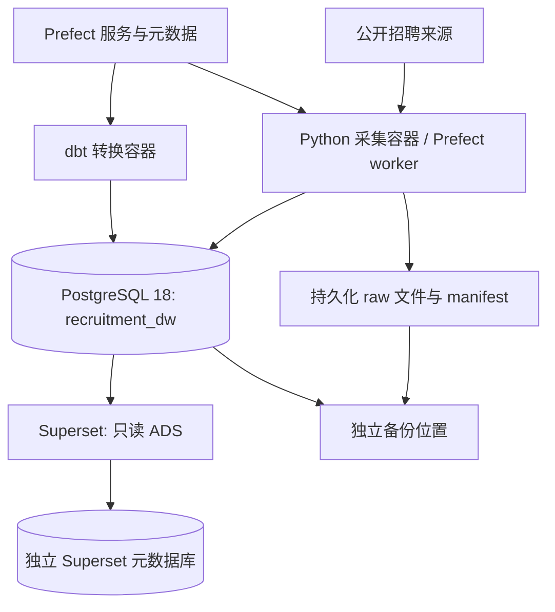

# 5. 物理设计

[设计目录](README.md) · 上一章：[逻辑设计](04_逻辑设计.md)

## 5.1 技术选型与版本策略

以下为**拟实施技术栈**，不是已安装或已测试的运行环境。选用受支持的稳定版本，避免新技术堆砌，也不使用停止维护的旧版本。

| 职责 | 选型 | 选择理由与限制 |
| --- | --- | --- |
| Python 运行与依赖 | Python 3.13、uv、锁文件 | 现代受支持运行时，依赖可复现；试采用 3.12 不代表最终运行版本已验证 |
| HTTP 采集 | HTTPX，标准 HTML/JSON 解析；按需使用 selectolax | 超时、连接管理和异步能力；初期每域单并发，不能因工具支持并发就增加网站负担 |
| 采集契约 | Pydantic 2 | 显式类型与校验错误；源原值和规范字段分开，不静默强转长 ID |
| 编排 | Prefect 3 | Python flow/task、定时、运行状态和有限重试；采集服务与 dbt 执行分任务 |
| 分层转换 | dbt 的稳定 Python Core 系列＋匹配的 dbt-postgres，SQL 模型 | `source/ref` 依赖、模型测试、文档和血缘；不采用 Postgres 不支持的 dbt Python 模型 |
| 数仓存储 | PostgreSQL 18 当前受支持补丁版 | 事务、约束、窗口函数、JSONB、索引足够支撑课程规模；不采用预发行版 |
| BI | Apache Superset 稳定版独立镜像 | 多维筛选、图表和 SQL 数据集；只读 ADS，单独元数据库 |
| 部署 | Docker Compose v2，Windows 使用 WSL2/Linux 容器 | 统一团队环境；开发环境与依赖隔离，减少“只有一人能运行” |
| 版本协作 | GitHub、PR、Actions | 代码/设计/轻量验收；CI 使用小型脱敏必要字段样本，不在每次提交全量抓站 |

dbt 官方兼容性说明已列出 Python 3.13 对 Postgres 适配器的支持（v1.10 起的说明），但不能据此推断任意版本组合都兼容。实施阶段选择当时仍受支持的 dbt Core/适配器组合，执行安装、连接、建模、测试和发布冒烟验证后锁定精确版本；Superset、Prefect 使用各自镜像，不强迫共用 Python 环境。

不引入 Hadoop/HDFS、Spark 集群或 Kafka：目前是小中规模、每日离线招聘观察，没有流式事件源，也没有证明单机吞吐不足。这些组件会增加部署和排障成本，却不直接解决重复、粒度和口径问题。后续以实际数据量和执行计划决定扩展，而不是以组件数量证明工作量。

## 5.2 部署与存储布局

图 5-1：单机课程部署逻辑。Prefect 和 Superset 元数据使用各自独立数据库/角色，可与数仓共用一个 PostgreSQL 实例但不得混写业务 Schema；如选定的 Prefect 服务版本需要 Redis，则仅作为编排消息/协调依赖，使用内部网络，不进入数仓业务分层。

建议演示机 4 核以上、16 GB RAM、20 GB 可用空间；这是起步配置而非实测容量承诺。核心数仓数据库名 `recruitment_dw`，UTF-8，Schema 为 `ods/dim/dwd/dws/ads/audit`。内部容器服务互通，宿主端口仅绑定 `127.0.0.1`；组员默认各自部署，原始批次通过共享存储传递。

原始响应采用内容寻址文件（SHA-256）及批次清单，UTF-8 JSONL 为接入格式；正文不重复进 Git。首版保留原始文件至课程验收结束，之后按组内约定处理；不能在验收前删除重建依赖。公开字段也不等于可以无条件再发布完整网页，原始正文默认只在组内保留。

## 5.3 容量估算方法

设计压力规模假设：1 万来源岗位/日×14 日＝14 万条观察；若规范正文平均 10 KB，正文逻辑量约 1.4 GB，另加页面包装、版本、索引、WAL、元数据和备份。此数字用于规划，**不是当前已采量或磁盘实测**。

原始列表响应含多个岗位，不能把每个岗位都复制一份完整列表响应；以引用共享文件。内容未变时观察只引用已有内容版本，避免每日重复存正文。首次小批运行需记录文件字节数、平均记录大小、数据库/索引占用和备份量，再调整保留策略。

## 5.4 物理字段与约束

| 字段类别 | 类型/约束 | 原因 |
| --- | --- | --- |
| 来源岗位 ID | TEXT，非空；与 source_key 组合 UNIQUE | 源 ID 可能很长或含字母，不转浮点 |
| 代理键 | BIGINT GENERATED BY DEFAULT AS IDENTITY | 身份稳定，与源 ID 解耦；维度未知成员固定 0，来源身份不可用未知掩盖 |
| 批次 ID、规则版本 | TEXT，非空，长度合理性在契约校验 | 允许来源＋时间戳；不将单纯运行时间当内容版本 |
| 日期键 | INTEGER，引用 dim_date | 与真实 DATE 唯一对应；分析日按 Asia/Shanghai |
| 采集/审计时间 | TIMESTAMPTZ，非空 | 保留绝对时间；来源原始时间另存 TEXT，解析结果可空 |
| 原字段/证据 | JSONB；正文 TEXT；文件相对路径 TEXT | 保留结构与溯源；文件引用不可越出数据根目录 |
| SHA-256 | CHAR(64)，十六进制 CHECK | 验证输入，内容哈希与文件哈希分列 |
| 可选薪资 | NUMERIC(14,2)，可空，非负 CHECK；币种/周期分列 | 只保存可解释金额；上下界完整时 upper≥lower；缺失/面议保持 NULL |
| 运行计数 | BIGINT，非负 CHECK | 请求数、唯一 ID 数、失败数与岗位数分列 |
| 语境/状态 | TEXT＋CHECK/维度引用 | 批次 complete/partial/failed；技能强度、冲突和未知有明确代码 |

重点表的设计约束如下，完整 DDL 在实现阶段按本设计创建并测试，不能把本章伪装成已运行数据库：

| 表 | 主键/唯一约束 | 必要外键与检查 |
| --- | --- | --- |
| `dim.posting_identity` | PK posting_key；UNIQUE(source_key,source_job_id) | FK source_key；非空自然键 |
| `dim.posting_version` | PK version_key；UNIQUE(posting_key,valid_from_observed,version_sequence) | FK posting_key；to>from 或 NULL；同身份区间不重叠（构建断言；后续可加排他约束） |
| `audit.collection_batch` | PK batch_id | source、scope、开始/结束、业务成功与覆盖信息非空；结束≥开始 |
| `ods.posting_record` | PK(batch_id,posting_key) | FK batch 与 identity；原字段 JSONB、raw_refs 非空；隔离无效身份记录另存 rejected 输入 |
| `dwd.fact_posting_observation` | PK observation_key；UNIQUE(batch_id,posting_key) | FK(batch)、FK(version_key,posting_key) 指向版本表相应组合 UNIQUE，防止串岗 |
| `dwd.posting_job_map` | PK(mapping_version,posting_key) | FK job_key；归并证据及审核状态；禁止同版本重复映射 |
| `dwd.fact_job_daily` | PK(build_id,date_key,job_key) | FK build/date/job/代表版本及分类维度；job_count CHECK=1 |
| `dwd.job_daily_evidence` | PK(build_id,date_key,job_key,observation_key) | FK 每日快照组合键、FK 观察键 |
| `dwd.bridge_version_skill` | PK(version_key,skill_key,extractor_version,requirement_level) | FK 版本/技能；证据数组，语境允许值 |
| `dwd.bridge_version_location` | PK(version_key,location_key,normalization_version) | FK 版本/地点；去除重复地点关系 |
| `audit.publication_pointer` | 单行主键 singleton=1 | build_id 必须引用通过验收的构建；切换前由发布事务检查 |

所有外键默认禁止级联删除业务证据。ODS 保存失败原值不等于 DWD 接受错误值；拒绝表需保存批次、原始文件、源行号与原因，确保守恒核对。

## 5.5 索引、分区与物化

- 来源身份组合 UNIQUE 支撑按 ID 查找；版本表 `(posting_key,valid_from_observed DESC)` 支撑历史查询。
- 观察表 `(posting_key,observed_at DESC)` 支撑回溯；同批唯一索引已覆盖 batch 前缀，不再建完全相同索引。
- 每日快照主键覆盖 build/date/job；增加 `(build_id,date_key,category_key)`、`(build_id,date_key,company_key)`；城市/技能桥增加反向索引 `(location_key,version_key)`、`(skill_key,version_key)`。
- 原始 JSONB 默认不建全字段 GIN，正文不为无需求的全文搜索增加索引。按实际 `EXPLAIN (ANALYZE, BUFFERS)` 结果决定。
- 首版不分区；14 万观察假设下先测量单机性能。若持续增长至千万级且日期裁剪成为主要瓶颈，再评估按日期分区及包含分区键的唯一约束。
- DWD 持久表保留观察/版本；DWS 使用带 build_id 的构建结果表；ADS 使用只读视图选择发布指针。用明确构建/发布代替分散刷新视图导致的半成品可见。

## 5.6 ETL、幂等与原子发布

Prefect 编排：采集→保存文件/清单→Pydantic 契约校验→批量 COPY 入 ODS→内容版本与归并准备→dbt `build` 执行依赖模型和测试→构建验收→发布。

COPY 仅用于已经校验的结构化接入，不直接把无法解析的网页写入强约束事实。每批以 batch_id、文件哈希及契约版本登记；同一 batch_id 重跑内容必须相同，否则阻断而不是覆盖。新观察产生新批次。采用来源锁防止同一来源扫描并发冲突，构建与发布另有全局 advisory lock。

来源身份和原始观察追加保留。版本区间计算、技能桥及规则归并由明确的规则版本生成；重建从不可变 ODS 输入按观察时间排序处理。SCD Type 2 描述的是观察有效期，不假设 dbt 当前态 snapshot 能自动恢复试采前历史。

发布流程：

1. 取得 build_id，固定 scope/mapping/extractor/schema/code 版本与 `build_batch` 输入集合。
2. 新 build 写入新的每日快照和汇总分区逻辑集合；旧 build 不修改。
3. 全部校验通过，构建状态改为 ready；失败记录原因，不触碰发布指针。
4. 在一个短数据库事务中加锁、复查 ready 状态、原子更新 `publication_pointer`，提交。
5. ADS 只读取指针所选 build；保留上一版本供回滚。看板单次查询一致，多图如需严格同版本由页面固定 build_id 参数。

dbt 不承担整个流水线单事务承诺。失败重跑同一 build 必须清理/替换该未发布 build 的中间产物，不能追加重复；已发布 build 不原地重写。迁移表结构需要显式迁移脚本与兼容视图，不能随意重建并丢弃历史。

## 5.7 账号、备份和恢复

采集账号只写接入与运行审计；转换账号维护目标模型；发布账号切指针；Superset 只读 ADS，不开放原始正文/凭据。开发环境允许组合角色以简化部署，但权限边界需在实际账号测试中验证。所有口令通过环境变量/secret 注入，不进入 Git、日志或截图。

备份覆盖数据库 `pg_dump`、原始文件与清单、规则版本、代码锁文件、Superset 元数据库/导出。备份复制到独立位置；同磁盘副本不视为抗磁盘故障恢复。正式演示前在空实例恢复一次，对比输入哈希、岗位计数及关键指标。目标：恢复到最近一次验收通过的发布版本；具体 RPO/RTO 通过实测填写，不先承诺分钟级恢复。

## 5.8 实施前验证与验收

技术可用性门槛：安装锁定依赖→容器互通→dbt Postgres 连接→小批 COPY→模型构建与断言→原子发布→Superset 只读查询→故意失败仍读旧版本→空库恢复。只有通过才将选型标记“已实现”。若某组合失败，优先调整补丁/隔离环境，不无记录替换核心架构。

与第 2 章一致，性能测试记录实际硬件、数据量、首次/重复运行、查询计划及三次测量。测试应覆盖多地点/技能放大、同批重跑、字段冲突、范围变化、缺失源批次、A→B→A 内容版本和代表来源切换；测试夹具明确标为测试数据，不加入正式招聘样本。

## 5.9 官方技术依据

核对日期：2026-10-30；链接用于版本选择与实现核验，不代表本机已经部署。

- [PostgreSQL 版本支持策略](https://www.postgresql.org/support/versioning/)：选择仍受支持的稳定主版本及补丁。
- [dbt Python 兼容性](https://docs.getdbt.com/faqs/Core/install-python-compatibility)与[Postgres 适配器](https://docs.getdbt.com/docs/local/connect-data-platform/postgres-setup)：核对 Python/适配器组合。
- [Prefect 3 文档](https://docs.prefect.io/v3/get-started)与[Docker Compose 自托管](https://docs.prefect.io/v3/how-to-guides/self-hosted/docker-compose)：核对服务依赖与编排部署。
- [Superset 文档](https://superset.apache.org/docs/intro)：按实际稳定版本配置数据库连接和权限。

设计原则参考 Ralph Kimball、Margy Ross《The Data Warehouse Toolkit》第三版及《大数据之路：阿里巴巴大数据实践》的分层思想；具体课程交付约束以根目录新版要求及模板为准。
