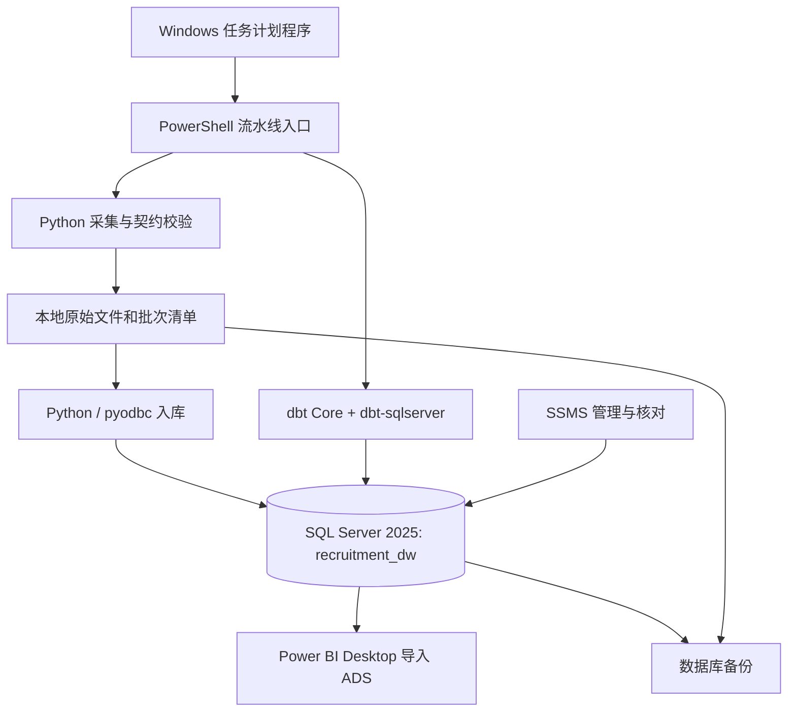

# 5. 物理设计

[设计目录](README.md) · 上一章：[逻辑设计](04_逻辑设计.md)

## 5.1 已确定的部署路线与工具职责

本版确定采用 **Windows 本机部署：Python 采集及入库 → SQL Server 2025 → dbt 分层转换 → Power BI Desktop**。SSMS 用于管理数据库，Windows 任务计划程序负责定时启动流水线。该路线利用课堂数据库基础，同时引入模型依赖、自动质量测试、文档和血缘等现代工程方法。

教师要求为“设计及实现工具、平台和技术不限（尽量采用当下主流技术）”，未强制 SSIS。本项目因此不将 SSIS 作为必装组件；它与 dbt 不需要重复执行同一套转换。SSMS 是管理客户端，SQL Server 是实际存储和执行 SQL 的服务，dbt 在 Python 环境中编译并提交 T-SQL，不是另一个数据库。

| 职责 | 本版选型 | 运行位置及边界 |
| --- | --- | --- |
| 数据库存储 | SQL Server 2025 Developer 系列，主实例 `localhost` | Windows 数据库服务；开发/教学用途，不作为商业生产授权 |
| 数据库管理 | 与实例兼容的 SSMS | Windows 桌面客户端，查看表、执行 T-SQL、检查计划和恢复备份 |
| 采集与字段校验 | Python 3.12、HTTPX、Pydantic 2 | 仓库内 `.venv`；复用已存在的 Python 3.12，不为升级而更换运行时 |
| 数据入库 | pyodbc + Microsoft ODBC Driver 18 | 参数化批量写入及事务；负责 JSONL 到 ODS，不要求 dbt 读取网页 |
| 仓内转换 | dbt Core 1.12.x + `dbt-sqlserver[pyodbc]` 1.12.1 候选基线 | 独立 `.venv-dbt`，SQL 模型使用 T-SQL；社区适配器，兼容验证后锁定精确依赖 |
| 调度与运行 | Windows 任务计划程序 + PowerShell 入口 | 串联采集、验收、入库、dbt、发布；保留退出码和运行日志 |
| 可视化 | Power BI Desktop，Import 模式 | 本地读取 ADS，展示发布版本和数据刷新时间；课堂演示不依赖付费云共享 |
| 团队协作 | GitHub + Python 依赖锁文件 + 环境示例 | 管理设计、代码、dbt 模型、必要清单和验收，同时管理按批次提交的完整原始响应和岗位数据 |

不再要求安装 PostgreSQL、Docker/WSL2、Prefect、Superset，也不新增常驻编排服务。SSIS、SQL Server Agent、SSAS 均不是本版运行前置条件；老师后续若明确要求使用，再按职责扩展并更新设计。

### 环境证据与待验证项（2026-10-30）

- 本机默认实例已通过 Windows 身份认证完成只读连接，返回 `17.0.1000.7 / Standard Developer Edition (64-bit)`；选择该 SQL Server 2025 实例作为主环境，不修改已有其他课程数据库。
- 注册信息另有 `SQL2019`，版本 `15.0.2000.5 / Developer Edition`；它不是本项目默认连接目标，未据此宣称该实例可连接。
- 已检测到 64 位 ODBC Driver 18；本机 Python 3.12 已用于试采。SSIS 的 DTExec 文件存在不代表需要使用 SSIS，也不等于所有开发组件已验证。
- PyPI 当次返回 `dbt-sqlserver` 1.12.1，要求 Python ≥3.10、dbt Core ≥1.12.0 且 <2.0。维护者当前文档列出 Python 3.12 和 SQL Server 2025 的测试支持；本项目选择同一 1.12 系列，仍须实际安装、`dbt debug`、构建和失败回滚测试。
- 本次只读连接使用本机共享内存；不能据此宣布 pyodbc/dbt 的 TCP 连接已验证。Power BI、SSMS 的具体客户端版本和端到端链路尚未验收。数据库补丁升级由实施检查决定，本次不更改软件或服务配置。

## 5.2 本机布局、运行与团队复现

图 5-1：所有主要组件运行于 Windows。SQL Server 在后台运行；SSMS 和 Power BI 仅在管理、刷新或演示时打开。dbt 是命令行任务，运行结束后退出。

建议演示机 4 核以上、16 GB RAM、至少 20 GB 可用磁盘；这是待小批测量修正的规划。SQL Server 内存上限需为 Windows、Python 和 Power BI 留出空间，由实施时按实际资源设置，不直接占满机器。

| 项目 | 约定 |
| --- | --- |
| 数据库 | 新建专用 `recruitment_dw`，Schema 为 `ods/dim/dwd/dws/ads/audit`；开发者使用各自独立数据库，避免相互覆盖 |
| 文本与时间 | JSONL 文件 UTF-8；数据库中文列显式 NVARCHAR；审计时间 DATETIMEOFFSET，以 UTC 保存，分析日期换算北京时间 |
| 数据目录 | `data/<source>/<batch_id>/` 内含 raw、jobs、manifest、requests、quality_issues、README，全部由 Git 跟踪；文件哈希可追踪 |
| Python 环境 | `.venv` 运行采集/校验/入库；`.venv-dbt` 运行转换；实施时分别锁定依赖，入口使用绝对解释器路径 |
| dbt 配置 | `profiles.yml` 的 target 类型为 `sqlserver`，ODBC 18；个人配置放用户目录，Git 仅保存不含凭据的示例 |
| 连接方式 | 同机 Windows 身份认证优先；实施时核对 TCP/IP，配置经确认的本地端口，以 `localhost` 和实际端口连接，不能假设端口已为 1433 |
| 网络与证书 | 不开放公网端口；启用连接加密。本机开发自签名证书若需信任，明确仅用于本机；跨机器必须核对证书及最小网络授权 |
| 演示文件 | `dashboards/` 保存报表说明及受控文件；PBIX 含导入数据，按实际大小和字段决定共享存储或 Git LFS，不默认提交完整正文 |

调度目标仍为每日北京时间 22:30。A/B 在各自电脑采集所负责来源，C 在批次到齐且验收后加工，不能假定跨电脑任务会自动按先后完成。最终演示机可以运行统一入口串行完成链路；缺源时记录不完整并保留上一发布版本。任务设置为已有运行时不启动新实例，脚本还要持有运行锁；配置工作目录、实际 Windows 身份、解释器路径、退出码及日志。计划任务使用的身份必须能够登录数据库并访问数据路径，不能只验证交互终端。

机器睡眠/关机可能错过采集。补跑记录真实时间，不补造昨日快照；漏采日按不完整处理。Power BI Desktop 首版由使用者手动刷新，数据库发布完成不等于报表已经刷新。刷新时固定一个已验收 build_id 给所有数据查询，全部成功后保存报表；失败保持上一报表版本。报表显式显示 build_id、分析日及刷新时间，避免不同图表混入不同构建。

四人无需都搭全套：A/B 必须有采集环境，C 负责主数仓和 dbt，D 安装 Power BI Desktop；D 可在自己的兼容 SQL Server 实例恢复批准备份或导入交付的 ADS 数据。正式验收时至少另一名成员按相同依赖、DDL、批次与步骤完成复现。2025 数据库备份不能直接恢复到 2019，恢复路径需相同或支持的更高版本；较低版本成员走脚本和原始批次重建并另测兼容性。

原始响应与清单保留至课程验收结束。采集数据通过 GitHub 分支及 PR 交接，合并后 git pull 获取；本地绝对路径、凭据和个人配置不写死在项目 SQL 中。以下均为设计，不表示项目库、计划任务或报表已经创建。

## 5.3 容量估算方法

设计压力规模假设：1 万来源岗位/日×14 日＝14 万条观察；若规范正文平均 10 KB，正文逻辑量约 1.4 GB，另加页面包装、版本、索引、事务日志、元数据和备份。此数字用于规划，**不是当前已采量或磁盘实测**。

原始列表响应含多个岗位，不能把每个岗位都复制一份完整列表响应；以引用共享文件。内容未变时观察只引用已有内容版本，避免每日重复存正文。首次小批运行需记录文件字节数、平均记录大小、数据库/索引占用和备份量，再调整保留策略。

## 5.4 物理字段与约束

| 字段类别 | 类型/约束 | 原因 |
| --- | --- | --- |
| 来源岗位 ID | NVARCHAR(200)，非空，BIN2 排序规则；与 source_key 组合 UNIQUE | 源 ID 可能很长或含字母，不转浮点 |
| 代理键 | BIGINT IDENTITY(1,1) | 身份稳定，与源 ID 解耦；维度未知成员固定 0，来源身份不可用未知掩盖 |
| 批次 ID、规则版本 | VARCHAR(128)，非空；受控 ASCII 编码 | 允许来源＋时间戳；不将单纯运行时间当内容版本 |
| 日期键 | INT，引用 dim.date | 与真实 DATE 唯一对应；分析日按 Asia/Shanghai |
| 采集/审计时间 | DATETIMEOFFSET(7)，非空 | 统一保存 +00:00；来源原始时间另存 NVARCHAR(200)，解析结果可空 |
| 原字段/证据 | NVARCHAR(MAX) + ISJSON 检查；正文 NVARCHAR(MAX)；路径 NVARCHAR(1024) | 保留结构与溯源；文件引用不可越出数据根目录 |
| SHA-256 | CHAR(64)，十六进制 CHECK | 验证输入，内容哈希与文件哈希分列 |
| 可选薪资 | NUMERIC(14,2)，可空，非负 CHECK；币种/周期分列 | 只保存可解释金额；上下界完整时 upper≥lower；缺失/面议保持 NULL |
| 运行计数 | BIGINT，非负 CHECK | 请求数、唯一 ID 数、失败数与岗位数分列 |
| 语境/状态 | VARCHAR(32)＋CHECK/维度引用 | 批次 complete/partial/failed；技能强度、冲突和未知有明确代码 |

SQL Server 标识列默认从 1 起，未知维度成员 0 通过受控初始化脚本配合 `IDENTITY_INSERT` 写入。来源代码和来源岗位 ID 使用区分大小写的二进制排序规则，避免默认不区分大小写而误合并；ID 长度超过上限时隔离并修订字段，禁止截断。正文和 JSON 显式 NVARCHAR，禁止使用已弃用的 TEXT/NTEXT 类型。JSON 保存原值并用 ISJSON 校验，分层解析使用 OPENJSON；北京时间转换使用 SQL Server 的 `China Standard Time` 时区名。

重点表的设计约束如下，完整 DDL 在实现阶段按本设计创建并测试，不能把本章伪装成已运行数据库：

| 表 | 主键/唯一约束 | 必要外键与检查 |
| --- | --- | --- |
| `dim.posting_identity` | PK posting_key；UNIQUE(source_key,source_job_id) | FK source_key；非空自然键 |
| `dim.posting_version` | PK version_key；UNIQUE(posting_key,valid_from_observed,version_sequence) | FK posting_key；to>from 或 NULL；同身份区间不重叠（串行写入与区间重叠断言，不使用 PostgreSQL 排他约束） |
| `audit.collection_batch` | PK batch_id | source、scope、开始/结束、业务成功与覆盖信息非空；结束≥开始 |
| `ods.posting_record` | PK(batch_id,posting_key) | FK batch 与 identity；原字段 JSON 文本、raw_refs 非空；隔离无效身份记录另存 rejected 输入 |
| `dwd.fact_posting_observation` | PK observation_key；UNIQUE(batch_id,posting_key) | FK(batch)、FK(version_key,posting_key) 指向版本表相应组合 UNIQUE，防止串岗 |
| `dwd.posting_job_map` | PK(mapping_version,posting_key) | FK job_key；归并证据及审核状态；禁止同版本重复映射 |
| `dwd.fact_job_daily` | PK(build_id,date_key,job_key) | FK build/date/job/代表版本及分类维度；job_count CHECK=1 |
| `dwd.job_daily_evidence` | PK(build_id,date_key,job_key,observation_key) | FK 每日快照组合键、FK 观察键 |
| `dwd.bridge_version_skill` | PK(version_key,skill_key,extractor_version,requirement_level) | FK 版本/技能；证据数组，语境允许值 |
| `dwd.bridge_version_location` | PK(version_key,location_key,normalization_version) | FK 版本/地点；去除重复地点关系 |
| `audit.publication_pointer` | 单行主键 singleton=1 | build_id 必须引用通过验收的构建；切换前由发布事务检查 |

主外键、CHECK 和索引由版本化 DDL 创建；dbt 测试不能替代数据库约束。DIM/ODS/DWD 的持久对象不能因 dbt 默认 table 重建而丢失代理键或约束，使用受控增量/存储过程写入并在实现时测试。dbt 以 source/ref 管理依赖；定制 schema 生成宏使目标精确为 ods/dim/dwd/dws/ads，避免默认生成 dbo_dwd 等意外名称。

所有外键默认禁止级联删除业务证据。ODS 保存失败原值不等于 DWD 接受错误值；拒绝表需保存批次、原始文件、源行号与原因，确保守恒核对。

## 5.5 索引、分区与物化

- 来源身份组合 UNIQUE 支撑按 ID 查找；版本表 `(posting_key,valid_from_observed DESC)` 支撑历史查询。
- 观察表 `(posting_key,observed_at DESC)` 支撑回溯；同批唯一索引已覆盖 batch 前缀，不再建完全相同索引。
- 每日快照主键覆盖 build/date/job；增加 `(build_id,date_key,category_key)`、`(build_id,date_key,company_key)`；城市/技能桥增加反向索引 `(location_key,version_key)`、`(skill_key,version_key)`。
- 首版使用行存储及显式聚集/非聚集索引；dbt 表模型和测试失败表设置 `as_columnstore: false`，避免适配器默认列存策略与长文本及小规模点查不匹配。通过 SSMS 实际执行计划、`SET STATISTICS IO, TIME ON` 测量；有证据后再评估列存或 JSON 计算列索引。
- 首版不分区；14 万观察假设下先测量单机性能。若持续增长至千万级且日期裁剪成为主要瓶颈，再评估按日期分区及包含分区键的唯一约束。
- DWD 持久表保留观察/版本；DWS 使用带 build_id 的构建结果表；ADS 的当前结果视图选择发布指针，另提供带 build_id 参数的只读内联表值函数，仅允许读取已验收且曾发布的构建，供 Power BI 固定版本导入。用明确构建/发布代替分散刷新视图导致的半成品可见。

## 5.6 ETL、幂等与原子发布

PowerShell 入口依次运行：采集→保存文件/清单→Pydantic 契约校验→pyodbc 参数化批量写入 ODS→内容版本与归并准备→dbt `build` 执行依赖模型和测试→构建验收→发布。每一步非零退出即停止，Windows 任务计划程序只负责启动，不替代步骤检查。

批量写入仅接收已经校验的结构化输入，按批提交事务；可在验证长文本和 NULL 处理后启用 `fast_executemany`，不把它当幂等保障。每批以 batch_id、文件哈希及契约版本登记；同一 batch_id 重跑内容必须相同，否则阻断而不是覆盖。新观察产生新批次。采用来源锁防止同一来源扫描并发冲突，构建与发布另用 SQL Server `sp_getapplock` 应用锁，检查返回值和超时并在结束时释放。

来源身份和原始观察追加保留。版本区间计算、技能桥及规则归并由明确的规则版本生成；重建从不可变 ODS 输入按观察时间排序处理。SCD Type 2 描述的是观察有效期，不假设 dbt 当前态 snapshot 能自动恢复试采前历史。

发布流程：

1. 取得 build_id，固定 scope/mapping/extractor/schema/code 版本与 `build_batch` 输入集合。
2. 新 build 写入新的每日快照和汇总分区逻辑集合；旧 build 不修改。
3. 全部校验通过，构建状态改为 ready；失败记录原因，不触碰发布指针。
4. 在一个短 T-SQL 事务中（`XACT_ABORT ON`、TRY/CATCH、失败回滚）加锁、复查 ready 状态、原子更新 `publication_pointer`，提交。
5. ADS 当前视图读取指针所选 build；保留已发布历史版本供回滚和固定版本导入。Power BI Import 刷新前固定 build_id，所有查询读取该构建；首次取得指针后改用授权的 ADS 按版本查询接口，不能在各查询中独立重读当前指针。

dbt 不承担整个流水线单事务承诺。失败重跑同一 build 必须清理/替换该未发布 build 的中间产物，不能追加重复；已发布 build 不原地重写。迁移表结构需要显式迁移脚本与兼容视图，不能随意重建并丢弃历史。

## 5.7 账号、备份和恢复

采集账号只写接入与运行审计；转换账号维护目标模型；发布账号切指针；Power BI 数据访问身份只读 ADS，不开放原始正文/凭据。开发环境允许组合角色以简化部署，但权限边界需在实际账号测试中验证。本机优先 Windows 身份认证；需要口令时通过受保护的环境配置注入，不进入 Git、日志或截图。

备份覆盖 SQL Server `BACKUP DATABASE` 生成的 `.bak`、原始文件与清单、规则版本、依赖锁文件、Power BI 报表及连接参数说明。课程库首版使用 SIMPLE 恢复模式并在合格发布后执行完整备份；不承诺时间点恢复。备份路径需 SQL Server 服务账号有权限，不能用本机交互用户权限替代。备份复制到独立位置；同磁盘副本不视为抗磁盘故障恢复。正式演示前在空实例恢复一次，对比输入哈希、岗位计数及关键指标。目标：恢复到最近一次验收通过的发布版本；具体 RPO/RTO 通过实测填写，不先承诺分钟级恢复。

## 5.8 实施前验证与验收

技术可用性门槛：锁定两个 Python 环境→ODBC/实际 Windows 账号连接→`dbt debug`→中文、长 ID、NULL 和时区入库→模型构建与断言→原子发布→Power BI 固定版本刷新→故意失败仍读旧版本→计划任务身份运行→空库恢复。只有通过才将选型标记“已实现”。若某组合失败，优先调整补丁/隔离环境，不无记录替换核心架构。

与第 2 章一致，性能测试记录实际硬件、数据量、首次/重复运行、查询计划及三次测量。测试应覆盖多地点/技能放大、同批重跑、字段冲突、范围变化、缺失源批次、A→B→A 内容版本和代表来源切换；测试夹具明确标为测试数据，不加入正式招聘样本。

## 5.9 技术依据与实施边界

核对日期：2026-10-30；链接用于版本选择与实现核验，不代表本机已经部署。

- [SQL Server 2025 版本与支持功能](https://learn.microsoft.com/en-us/sql/sql-server/editions-and-components-of-sql-server-2025)：核对引擎、版本和开发用途。
- [dbt-sqlserver 维护者文档](https://github.com/dbt-msft/dbt-sqlserver)及[PyPI 包元数据](https://pypi.org/project/dbt-sqlserver/)：本次已读取支持版本、安装方式与依赖；固定版本须另经本项目验证。
- [dbt SQL Server 连接配置](https://docs.getdbt.com/reference/warehouse-profiles/mssql-profile)：实施时核对认证、ODBC、端口和加密参数。
- [Microsoft ODBC Driver](https://learn.microsoft.com/en-us/sql/connect/odbc/download-odbc-driver-for-sql-server)与[Power BI SQL Server 连接器](https://learn.microsoft.com/en-us/power-query/connectors/sql-server)：作为驱动和报表连接实施依据。

部署路线已确定，端到端验证未完成。本次没有安装软件、创建数据库、启用 TCP/IP、修改服务、创建计划任务或开始正式采集；这些是第六章系统实现阶段的交付。

设计原则参考 Ralph Kimball、Margy Ross《The Data Warehouse Toolkit》第三版及《大数据之路：阿里巴巴大数据实践》的分层思想；具体课程交付约束以根目录新版要求及模板为准。
